# IsoProbe 预实验报告：现代 LLM 隐藏表征的各向同性

> **这是预实验。** 模型集合不构成按规模或家族设计的对照。第 1 轮只用本地已有模型（GPT-2 small 除外，为正确性检查下载）；
> 第 2 轮按需补下载了 gpt2-medium/large/xl 和两个 base 模型（Llama-3.1-8B、Qwen3-8B-Base），见 `models_local.md`。
> 现代模型中只有这两对是 base 与 post-trained 的同架构配对，其余 4 个现代模型只有 instruct / post-trained 版本。

日期：2026-10-28。Slurm array 9725（第 1 轮，7 个任务）、9743（第 2 轮，12 个任务：新模型的 `measure.py` + 全部模型的
final-norm 分解）和 9769（第 3 轮，12 个任务），均为 `%2`、每任务 1 张 B300，全部 COMPLETED，单任务 1–4 分钟；
第 3 轮另有 CPU 任务 9770（词频）。第 4 轮（2026-10-28 至 29）：array 9802（STS，12 个任务）和 9832（训练动态，7 个任务、91 个 Pythia / OLMo-2 checkpoint），均为 `%2`，全部 COMPLETED。第 5 轮（2026-10-29）：array 9846（59 个 checkpoint 的 STS）和 9886（296 行），以及 CPU 任务 9851、9889、9908；检验预登记在 `configs/round5_prereg.md`。

## 1. 设置

| 项 | 设置 |
|---|---|
| 数据 | `Salesforce/wikitext` / `wikitext-103-raw-v1` / test。原论文用 WIT 的维基文本，这里用 wikitext 代替。段落 = raw 文件中非空、非标题的一行；≥100 词的候选只有 1085 段，seed=0 抽 1000 段（`data/samples.jsonl`），即几乎覆盖整个候选池。文本保留 wikitext 原始的 ` @-@ `、` , ` 等分词痕迹 |
| 分词 | 各模型自己的 tokenizer，`add_special_tokens=True`，截断到 256；平均长度 185–195 token（最短 100–103） |
| BOS | Llama-3.1（base 与 instruct，`<\|begin_of_text\|>`）和 Mistral（`<s>`）在 1000/1000 条上加了 BOS；GPT-2 系列、Qwen2.5、Qwen3（含 Base）、Olmo-3.1 都没加，位置 0 是普通文本 token（最常见为 `The`，226/1000） |
| 前向 | bf16，batch_size=1（无 padding），`output_hidden_states=True`，`torch.no_grad()`；指标全部 fp32；SDPA 关闭 cuDNN 后端（B300 上 cuDNN SDPA 无可用执行计划，与 TurnPrint 的做法一致） |
| 层 | `hidden_states[0]`（embedding 输出）、`round(k·L/8)` (k=1..7)、`hidden_states[-1]`。对每个模型检查了 `lm_head(hidden_states[-1])` 与 logits 的最大绝对差：12 个模型全部为 0.0，即最后一层确实是 **final norm 之后、LM head 之前** 的表示（图中用 ◆ 标注）|
| Token bank | 每条序列随机抽 10 个位置（均匀抽样），共 10000 个；其中约 62–64 个是位置 0（0.6%）。"去掉位置 0"版本把这些剔除 |
| 环境 | torch 2.11.0+cu128，transformers 5.16.1，seed=0，`/dataset1/zailong/envs/peft-sft-lab` |

指标定义按任务书：A = 1 − mean_x s(x)，s(x) = (‖Σu_i‖² − T)/(T(T−1))；B = 2 万对跨序列 token 的平均余弦（原始 / 减 bank 均值）；C = 中心化 bank 的奇异值谱，RankMe = exp(−Σ p log p)，p = σ/Σσ；D = 各维度 mean|h| 的 max/median，以及 ‖h₀‖/median‖h_t,t>0‖。

**Final-norm 分解**（`diag_final_norm.py`，第 2 轮新增）：用 hook 取 final norm 的输入 x（= 最后一个 block 的输出，不在 `hidden_states` 里），按 norm(x) = γ⊙x̂ + β 逐步重算 A/B/C：x → x̂（只归一化）→ γ⊙x̂ → γ⊙x̂+β（= `hidden_states[-1]`）；对带偏置的 LayerNorm 另算 post − β。所用序列与 bank 位置和 `measure.py` 完全相同。fp32 重算与模块输出的相对误差 ≤ 2e-3。

正确性：`tests/test_metrics.py`（9 个测试全过）验证了 O(Td) 公式与暴力两两余弦一致（含 bf16 输入、带均值偏移的输入）、跨序列配对不会抽到同一序列、RankMe 在已知秩数据上的取值。

## 2. 结果

### 2.1 最后一层（`hidden_states[-1]`，final norm 之后）

**全部位置**

| model | params | 版本 | BOS | A isotropy | B cos | B cos（中心化） | RankMe/d | top-1 var | top-10 var |
|---|---|---|---|---|---|---|---|---|---|
| gpt2 | 0.12B | base | no | **0.068** | 0.931 | 0.009 | 0.321 | 0.788 | 0.972 |
| gpt2-medium | 0.35B | base | no | 0.319 | 0.674 | 0.037 | 0.208 | 0.920 | 0.991 |
| gpt2-large | 0.77B | base | no | 0.708 | 0.163 | 0.000 | 0.840 | 0.040 | 0.204 |
| gpt2-xl | 1.56B | base | no | 0.723 | 0.149 | 0.000 | 0.836 | 0.035 | 0.185 |
| Qwen2.5-7B-Instruct | 7.62B | instruct | no | 0.600 | 0.293 | -0.001 | 0.670 | 0.164 | 0.475 |
| Llama-3.1-8B | 8.03B | **base** | yes | 0.703 | 0.140 | -0.000 | 0.724 | 0.052 | 0.234 |
| Llama-3.1-8B-Instruct | 8.03B | instruct | yes | 0.657 | 0.206 | -0.001 | 0.726 | 0.052 | 0.235 |
| Qwen3-8B-Base | 8.19B | **base** | no | **0.137** | 0.848 | 0.015 | 0.682 | 0.429 | 0.653 |
| Qwen3-8B | 8.19B | post-trained | no | 0.403 | 0.542 | 0.008 | 0.713 | 0.260 | 0.460 |
| Mistral-Small-24B-Instruct-2501 | 23.57B | instruct | yes | 0.596 | 0.291 | -0.000 | 0.648 | 0.127 | 0.418 |
| Olmo-3.1-32B-Instruct | 32.23B | instruct | no | 0.859 | 0.050 | -0.000 | 0.846 | 0.020 | 0.094 |
| Qwen3-32B | 32.76B | post-trained | no | 0.657 | 0.268 | -0.001 | 0.673 | 0.340 | 0.609 |

"去掉位置 0"版本见 `results/summary.md`：所有 12 个模型最后一层各指标变化 ≤ 0.014（最大为 gpt2-medium 的原始 B，其余 ≤ 0.007），不改变上表任何结论。

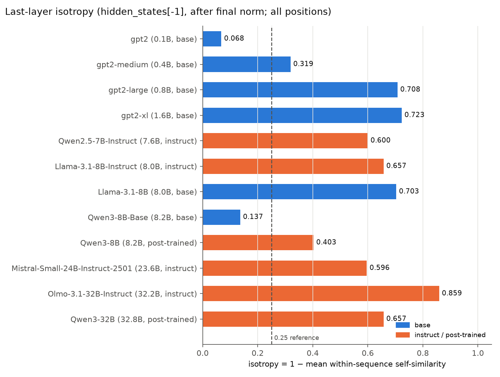

### 2.2 Final norm 分解（最后一层）

格式：A isotropy / B 原始跨序列余弦（全部位置）。

| model | norm | 偏置 β | 共享 emb | x（norm 前） | x̂ | γ⊙x̂ | γ⊙x̂+β（= 2.1 表） | post − β | max/median \|γ\| |
|---|---|---|---|---|---|---|---|---|---|
| gpt2 | LayerNorm | yes | yes | 0.153 / 0.825 | 0.153 / 0.825 | 0.076 / 0.923 | 0.068 / 0.931 | 0.076 / 0.923 | 13.9 |
| gpt2-medium | LayerNorm | yes | yes | 0.212 / 0.772 | 0.212 / 0.772 | 0.335 / 0.657 | 0.319 / 0.674 | 0.335 / 0.657 | 12.7 |
| gpt2-large | LayerNorm | yes | yes | 0.299 / 0.649 | 0.297 / 0.651 | 0.727 / 0.140 | 0.708 / 0.163 | 0.727 / 0.140 | 1.6 |
| gpt2-xl | LayerNorm | yes | yes | 0.416 / 0.545 | 0.318 / 0.630 | 0.740 / 0.130 | 0.723 / 0.149 | 0.740 / 0.130 | 1.5 |
| Qwen2.5-7B-Instruct | RMSNorm | no | no | 0.674 / 0.206 | 0.674 / 0.206 | 0.600 / 0.293 | 0.600 / 0.293 | – | |
| Llama-3.1-8B | RMSNorm | no | no | 0.687 / 0.166 | 0.687 / 0.166 | 0.703 / 0.140 | 0.703 / 0.140 | – | 1.2 |
| Llama-3.1-8B-Instruct | RMSNorm | no | no | 0.635 / 0.239 | 0.635 / 0.239 | 0.657 / 0.206 | 0.657 / 0.206 | – | 1.2 |
| Qwen3-8B-Base | RMSNorm | no | no | 0.340 / 0.613 | 0.340 / 0.613 | 0.137 / 0.848 | 0.137 / 0.848 | – | 5.2 |
| Qwen3-8B | RMSNorm | no | no | 0.391 / 0.557 | 0.391 / 0.557 | 0.403 / 0.542 | 0.403 / 0.542 | – | 5.2 |
| Mistral-Small-24B-Instruct-2501 | RMSNorm | no | no | 0.682 / 0.180 | 0.682 / 0.180 | 0.596 / 0.291 | 0.596 / 0.291 | – | |
| Olmo-3.1-32B-Instruct | RMSNorm | no | no | 0.857 / 0.053 | 0.857 / 0.053 | 0.859 / 0.050 | 0.859 / 0.050 | – | |
| Qwen3-32B | RMSNorm | no | no | 0.703 / 0.199 | 0.703 / 0.199 | 0.657 / 0.268 | 0.657 / 0.268 | – | |

γ 的 max/median 直接从 safetensors 里的 final norm 权重读出，只对 GPT-2 系列和两对 base/post-trained 模型算了（空格 = 未算）。
"共享 emb"= 模型加载后输入 embedding 与 LM head 是同一个张量（GPT-2 系列是；现代模型的 `tie_word_embeddings` 都是 False）。
含 top-1 方差和 β 的统计见 `results/summary.md` 末尾。

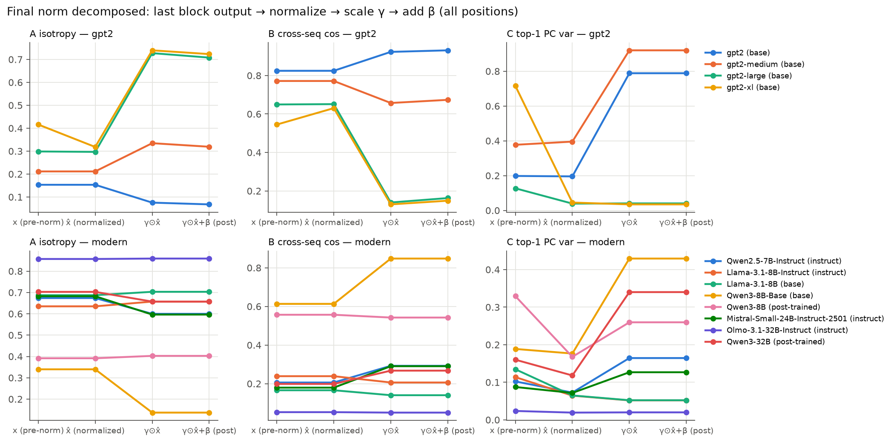

### 2.3 随深度变化

GPT-2 系列和现代模型分开画（每图 ≤ 8 条线）：

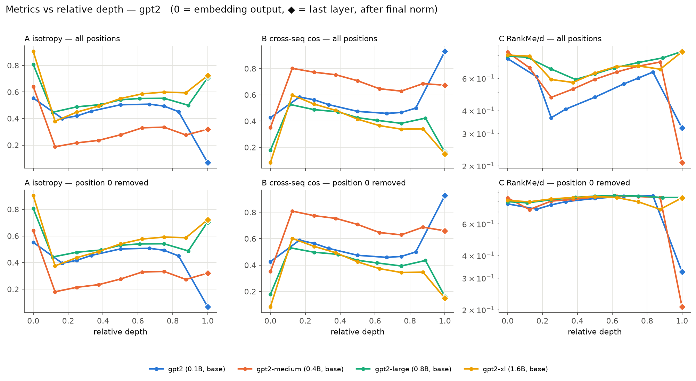
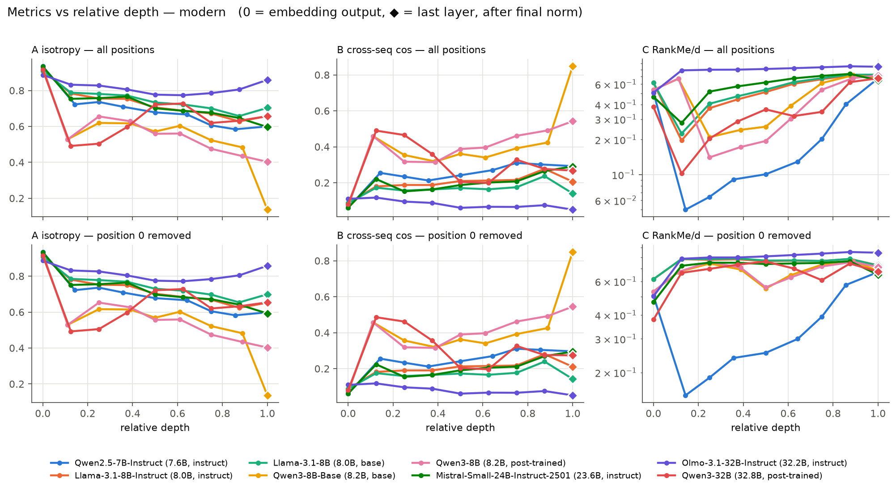
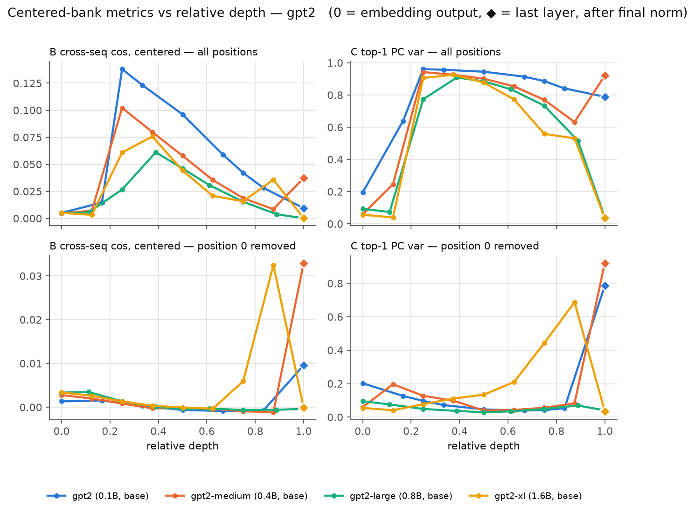
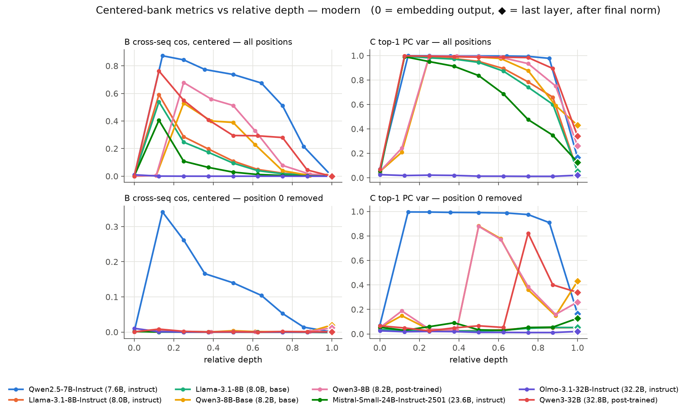
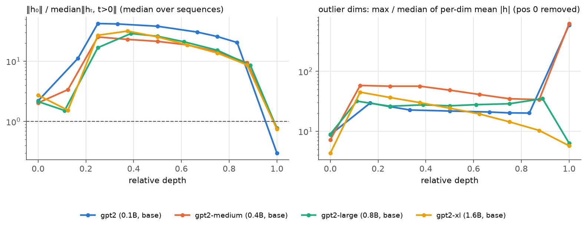
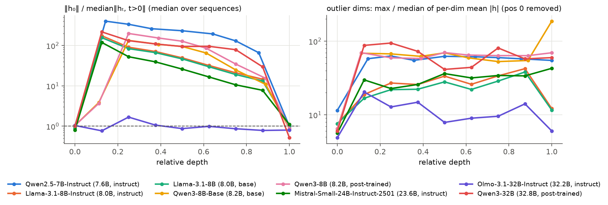

逐层数值见 `results/summary.md`，机器可读版见 `results/summary.csv`、`results/<model>.json`、`results/diag/<model>.json`。

## 3. 观察

### 3.1 与原论文的对照
- GPT-2 small 最后一层 isotropy = 0.068（50 条冒烟测试为 0.080），明显低于 0.25，与 Su & Collier 报告的"GPT-2 small 各向异性"一致。
- GPT-2 系列随规模：small 0.068 → medium 0.319 → large 0.708 → xl 0.723。分界在 medium 与 large 之间（**第 3 轮补充：这一分界只存在于 V3；在乘 γ 之前的 V1 中，GPT-2 随规模单调、平缓地上升，0.153 → 0.212 → 0.297 → 0.318，见第三轮结论摘要**）。medium 在本设置下略高于 0.25，但它的中间层 isotropy（0.19–0.33）是 12 个模型里最低的，最后一层 top-1 方差占比 0.92、离群维度比 630，都与 small 同类；large 和 xl 则在所有这些指标上都与现代模型同类。
- 原论文的结论"各向异性不是自回归 LM 的普遍性质"在这里成立，但**第 1 轮报告里"现代模型最后一层都高于 0.25"的说法不再成立**：Qwen3-8B-Base 最后一层 isotropy 只有 0.137，与 GPT-2 small 同一量级。

### 3.2 GPT-2 final LayerNorm 的偏置 β：不是主要原因
- 去掉 β 后，4 个 GPT-2 模型的原始跨序列余弦只变化 0.008–0.023（small 0.931 → 0.923），isotropy 变化 ≤ 0.02。β 的范数约为平均 token 向量范数的 5%（small/medium）到 21%（large/xl），且与平均 token 方向的余弦为 0.47–0.89，但它对 A、B 的贡献都很小。
- 该假设被否定，但 final norm 本身确实起作用：**作用来自逐维缩放 γ，而不是 β**（见 3.3）。
- 另外，norm 之前的最后一个 block 输出在 GPT-2 small 已经相当集中（x 的原始余弦 0.825，isotropy 0.153，而第 10 层只有 0.499 / 0.452）。第 1 轮报告"GPT-2 的各向异性只出现在最后一层"的说法不够准确：选中的层里没有第 11、12 个 block 的输出，集中至少从最后一个 block 已经开始。

### 3.3 逐维缩放 γ 决定最后一层是变窄还是变宽
- 只归一化（x → x̂）对 A、B 几乎没有影响（RMSNorm 是逐 token 缩放，A、B 严格不变；LayerNorm 的逐 token 去均值只在 gpt2-xl 上有可见作用）。
- γ 的作用方向因模型而异：
  - **变窄**：GPT-2 small（余弦 0.825 → 0.923）、Qwen3-8B-Base（0.613 → 0.848，isotropy 0.340 → 0.137）；Qwen2.5-7B-Instruct、Mistral、Qwen3-32B 也有小幅变窄（+0.07 – +0.11）。
  - **变宽**：gpt2-large（0.651 → 0.140）、gpt2-xl（0.630 → 0.130）、gpt2-medium（0.772 → 0.657）；Llama 两个版本小幅变宽。
  - 基本不变：Qwen3-8B、Olmo-3.1。
- γ 的尖峰程度（max/median |γ|）与结果一致：GPT-2 small/medium 为 13.9 / 12.7（各向异性），large/xl 为 1.6 / 1.5（各向同性）；Qwen3-8B 为 5.2，Llama-3.1-8B 为 1.2。在 GPT-2 small/medium 和 Qwen3-8B(-Base) 里，最后一层的离群维度正好就是 |γ| 最大的那几维（例如 GPT-2 small 的 496、430、314；Qwen3 的 2284、2202、3169），且与前一个选中层的离群维度不同。**（第 3 轮补充：这些维度在乘 γ 之前就已是均值主导的维度，离群不是只由 γ 造成，见 R3.2、R3.5。）**
- 注意：large/xl 在 norm 之前也相当集中（余弦 0.65 / 0.55），它们最后一层的各向同性是 γ 压平之后的结果，不代表最后一个 block 的输出本身是各向同性的。

### 3.4 共享输入/输出 embedding：不能解释本次的差异
- 4 个 GPT-2 模型全都共享 embedding，但 large/xl 最后一层是各向同性的（0.708 / 0.723）。
- 所有现代模型都不共享（`tie_word_embeddings=False`，加载后也确认输入 embedding 与 LM head 不是同一张量），但 Qwen3-8B-Base 最后一层是各向异性的（0.137），Qwen3-8B 也是现代模型中最低的（0.403）。
- 所以在本次 12 个模型里，共享 embedding 既不是最后一层各向异性的必要条件，也不是充分条件。这不否定 Gao 等人（2019）关于共享 embedding 训练出各向异性**词嵌入矩阵**的结论；本次测的是上下文隐藏表征。

### 3.5 base vs post-trained
- **Qwen3-8B**：base 0.137 → post-trained 0.403。差异几乎全部在最后一步：两者中间层曲线接近（base 0.48–0.62，post 0.43–0.66），norm 之前的 x 也接近（0.340 vs 0.391）；差别在 γ 这一步：base 被压到 0.137，post 保持 0.403。两者的 γ 几乎相同（‖Δγ‖/‖γ‖ = 0.3%，余弦 1.0000），所以差别来自 norm 输入 x 在大 γ 维度上的分布：最后一层最大离群维度（2284）的 mean|h| 从 156 降到 61。**（第 3 轮修改：只平移这一维只弥合 19% 的差距，需要约 8 个维度，见 R3.2、R3.5。）**
- **Llama-3.1-8B**：base 0.703 → instruct 0.657，各层曲线几乎重合（中间层 0.66–0.79 vs 0.63–0.78），γ 同样几乎没变（0.2%）。
- 只有两对，方向也不一致（Qwen3 post-training 提高 isotropy，Llama 略降），不能据此推断"后训练"对几何的一般影响。

### 3.6 位置 0 / 均值偏移的影响（第 1 轮结论，新模型同样成立）
- 位置 0 在中间层的范数远大于其他位置：中位比值峰值 Qwen2.5-7B 402×、Qwen3-32B 218×、Qwen3-8B 199×、Llama-Instruct 175×、Llama base 157×、Qwen3-8B-Base 134×、Mistral 119×、GPT-2 系列 25–42×。位置 0 是 BOS（Llama、Mistral）还是普通文本 token（Qwen、GPT-2）都有。**例外：Olmo-3.1-32B 全程不超过 1.7×。**最后一层（final norm 后）所有模型的比值回到 0.3–1.1。
- 对 **A 和原始 B** 几乎没有影响：12 个模型所有层，去掉位置 0 后 A 的变化 ≤ 0.012，原始 B 的变化 ≤ 0.014（gpt2-medium；其余模型 ≤ 0.006）。
- 对 **中心化 B 和 C（谱）影响很大**，尽管位置 0 只占 bank 的 0.6%：例如 Qwen3-32B 第 8 层中心化余弦 0.763 → 0.008，RankMe/d 0.102 → 0.664；Llama-Instruct 第 4 层中心化余弦 0.591 → 0.000，RankMe/d 0.196 → 0.784。即中间层"中心化后仍各向异性 / 低有效秩"的读数主要来自少数大范数 token。最后一层不受影响。

### 3.7 其他未解释的现象
- Qwen2.5-7B-Instruct 去掉位置 0 后，第 4–21 层仍然 top-1 方差占比 0.97–1.00、RankMe/d 只有 0.15–0.39，第 4 层中心化余弦 0.34。Qwen3-8B（第 18、22 层，top-1 0.88 / 0.77）和 Qwen3-32B（第 48 层，0.82）也有类似的局部尖峰。推测 bank 里还有其他位置的大范数 token，但**本次没有验证是哪些 token**。
- Olmo-3.1-32B 在所有指标上都不同于其他现代模型（全程 isotropy 0.77–0.86、无位置 0 范数尖峰、离群维度比 ≤ 21），原因未查。

## 第三轮：γ 折算、逐维分解、功能性干预

Slurm array 9769（12 个任务，`%2`，每任务 1 张 B300；gpt2 与 Qwen3-8B-Base 直接沿用 srun 冒烟测试的完整输出，任务内跳过）和 CPU 任务 9770（RTXq，无 `--gres`，词频统计），全部 COMPLETED。代码：`round3_lib.py`（共享函数）、`extract_round3.py`（GPU：步骤 0、步骤 1 的折算测试与 V0–V3 指标、步骤 3）、`analyze_round3.py`（登录节点：步骤 2、3b、汇总与图）、`count_unigrams.py`。完整数值见 `results/round3/summary.md` 与 `results/round3/analysis.json`。

补充分析（不用 GPU，登录节点 CPU，只读 `cache/banks/`、第一/三轮 JSON、config.json 和 safetensors 中的 LM head 权重）：`analyze_round3b.py` → `results/round3/followup.{md,json}`，对应下文的抵消检查（R3.3）、逐维明细（R3.6）、架构协变量（R3.7）和与中间层离群维度的比对（结论摘要第 5 条）。

与任务书的一处出入：步骤 1 的 V0–V3 指标（含 10000×d 的 SVD）放在 GPU 任务里用 `round3_lib.py` 计算，`analyze_round3.py` 读取结果，没有在登录节点重算。步骤 2 的维度排名在 GPU 任务（供步骤 3 使用）和 `analyze_round3.py` 中各算一次，12 个模型的前 8 维集合完全一致。

### R3.0 预期与结果对照

| # | 预期（假设） | 实际结果 | 是否一致 |
|---|---|---|---|
| 0a | 由 x 重建的 V3 与 `hidden_states[-1]` 相对误差 < 1e-2 | 12 个模型 1.7e-3 – 2.5e-3 | 一致 |
| 0b | bank 估计的 A 与第二轮全序列 A 相差 < 0.01；‖ū‖² 与第二轮 B 相差 < 0.01 | V0–V3 全部通过；最大 dA = 0.0066（gpt2-medium），最大 dB = 0.0037 | 一致 |
| 1a | γ 折算：最大相对误差 < 1e-4，argmax 一致率 ≥ 99.99% | 最大相对误差 ≤ 3.1e-6，argmax 一致率 100%（12/12） | 一致 |
| 1b | RMSNorm 模型 V0 与 V1 的 A、B 数值一致 | 8 个 RMSNorm 模型最大差 1.2e-7 | 一致 |
| 1c | GPT-2 small/medium、Qwen3-8B-Base：V1 的 isotropy 明显高于 V3 | small 0.153 vs 0.068（高，但 V1 本身已很低）；**medium 0.212 vs 0.319（V1 反而更低）**；Qwen3-8B-Base 0.340 vs 0.137 | 部分一致（2/3） |
| 1d | GPT-2 large/xl：V1 与 V3 差别不大，或 V3 更高 | 0.297 → 0.708，0.318 → 0.723（V3 高得多，γ 起稀释作用） | 一致 |
| 1e | （条件判读）V1 与 V3 下 12 个模型排序的 Spearman | isotropy ρ = 0.48（p = 0.09），原始 B ρ = 0.59（p = 0.02） | 排序明显改变 |
| 2a | 近似公式与精确值的误差 | −0.035 – +0.018（GPT-2 small/medium 最大，约 −0.035） | （无预设） |
| 2b | 三个各向异性模型的前 8 维贡献 > ‖ū‖² 的一半 | 0.999 / 0.998 / 0.904 | 一致（但另有 4 个非各向异性模型也 > 0.5，见 R3.2） |
| 2c | γ 换成常数后的余弦 = V1 的结果 | 12 个模型差值均为 0 | 一致 |
| 2d | 循环论证检查：前几维在 V1 中是否特殊 | 12 个模型中，V3 前 10 维在 V1 的均值占比 μ²/(μ²+σ²) 的中位百分位都 ≥ 0.978 | 这些维度在 V1 中就已特殊，**不是完全由 γ 造成** |
| 2e | Qwen3 base→instruct：k ≤ 8 弥合差距 > 70% | k=1: 19%，k=2: 32%，k=4: 63%，**k=8: 97%**，k=16: 108% | 一致（k = 8 时） |
| 2f | Llama 对照 | 差距方向相反且小（0.140 → 0.206）；k=16 也只弥合 25% | 作为对照：Llama 的差异不集中在前几维 |
| 3 | bite / bark（不预设阈值） | 12 个模型中，k ≥ 2 时前 k 维的 Δloss 都超过随机对照的最大 \|Δloss\|（2× – 7900×）。绝对值差异很大：Qwen3-8B-Base k=8 为 +4.96 nats/token；gpt2-large/xl、Olmo 在 k ≤ 32 时 ≤ 0.07 | 因模型而异，见 R3.3 |
| 3 | 线性捷径与直接计算一致 | 相对 logit 差 ≤ 3.4e-6 | 一致 |
| 3c | 抵消检查（补充）：Qwen3-8B-Base 在 k=8 时 corr(δ_S, δ_R) ≤ −0.55；Qwen2.5 在 k=4 时 ≤ −0.55（由已存的 sd 推出的上界） | −0.554；−0.616 | 一致（Qwen3-8B-Base 恰在界上） |
| 3b | W_U[:,S] m_S 与 log 词频显著正相关 | 全部维度：12 个模型 ρ = 0.57 – 0.66；前 k 维：72 项中 70 项为正，2 项为接近 0 的负值 | 一致，但不限于各向异性模型 |

### 结论摘要（以 V1 为主指标）

γ 折算测试表明，把 final norm 的 γ（和 β）折进 LM head 后模型输出不变，所以尺度在 γ 与 W_U 之间如何分配只是一种参数化约定。下面以不依赖这一约定的 **V1**（final norm 的输入，只做归一化、未乘 γ）为主指标。**V3**（= `hidden_states[-1]`，即前两轮的"最后一层"）定位为**基于余弦的下游应用**（直接取 `hidden_states[-1]` 做相似度、检索、聚类等）**看到的几何**，它包含 γ 的逐维缩放。

1. **GPT-2 随规模单调。** V1 isotropy：small 0.153 → medium 0.212 → large 0.297 → xl 0.318（原始 B：0.825 → 0.772 → 0.651 → 0.630）。前两轮在 V3 上看到的 medium 与 large 之间的"分界"（0.319 → 0.708）在 V1 下不存在：small/medium 的 γ 放大均值维度，large/xl 的 γ 压低均值维度（R3.2）。
2. **base / post-trained 差异约 ±0.05。** V1 下 Qwen3-8B 从 0.340 到 0.391（+0.05），Llama-3.1-8B 从 0.687 到 0.635（−0.05）。V3 下 Qwen3 的 0.137 → 0.403 是 γ 在约 8 个均值维度上把这一差异放大的结果（R3.2 反事实）。
3. **V1 下所有模型都没有维度坍缩。** 12 个模型 V1 的 RankMe/d（除以同 N、d 的高斯参照）为 0.75 – 0.92，稳健中心化 B ≤ 0.013，去掉位置 0 后基本不变（RankMe 变化 ≤ 0.008）。V1 的各向异性全部来自一个公共均值方向，而不是有效秩低。GPT-2 small/medium 在 V3 上的低有效秩（0.32 / 0.21）是 γ 造成的。
4. **V1 下的排序：** GPT-2 系列（0.15 – 0.32）与 Qwen3-8B-Base / Qwen3-8B（0.34 / 0.39）最低，其余 6 个现代模型为 0.635 – 0.857。与 V3 排序的 Spearman ρ = 0.48。R3.7 的架构协变量中，没有一项能单独把这 6 个模型与其余模型分开：例如 Qwen3-32B 与 Qwen3-8B 架构相同，V1 却是 0.703。
5. **最后一层的均值维度与中间层 massive activation 维度基本不重合。** 中间层离群维度取第一轮中间各层 `outlier_top5_dims` 的并集（不含 embedding 与最后一层；按各维 mean\|h\| 排序，含位置 0），与第三轮的 V3 前 10 维（`top10_dims`）比对：7 个模型重合 0 个，12 个模型合计 120 个位置中重合 9 个（最多是 gpt2-large 的 3 个）。这些中间层维度在 V1 中仍是均值主导的（均值占比百分位的中位数为 0.71 – 1.00），但在 10 个模型中，它们的 \|γ\| 位于最低的约 7% 以内（百分位中位数 ≤ 0.073），被 final norm 压低。例外是 Qwen2.5（0.95）和 Qwen3-32B（0.87）。注意：这里的"massive activation 维度"用第一轮的 mean\|h\| 离群维度近似，没有单独按 token 定位。
6. **功能上：** 去掉全部维度的均值在所有模型上都使 loss 增加 1.27 – 3.13 nats/token，包括 V1、V3 都各向同性的 Olmo。只去掉前 k 维时，代价取决于这些维度造成的 logit 偏移在词表上的离散程度，而不是它们对余弦的贡献。例如 GPT-2 small 第 496 维占 ‖ū‖² 的 75%，可加占比只有 0.05，Δloss 为 0.0001。在 Qwen3-8B-Base、Qwen2.5 和 Qwen3-32B 中，前 k 维的偏移与其余维度的偏移负相关、相互部分抵消，所以只去掉前 k 维的代价可以超过去掉全部维度（R3.3）。

### R3.1 γ 折算之后还剩多少各向异性（步骤 1）

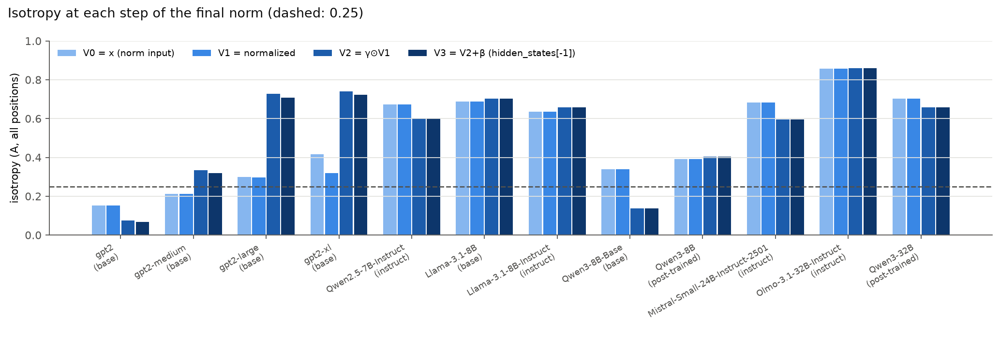

- 把 γ 折进 LM head（`W_U' = W_U·diag(γ)`，`b' = W_U β`）在数值上完全不改变模型输出，因此"最后一层"可以合法地取 V1 而不是 V3。GPT-2 的折算会解除输入/输出 embedding 的共享（只改输出头的副本）。
- 以 V1 计，三个各向异性模型变成：GPT-2 small 0.153（仍很低：残差流本身的公共分量已经很强，γ 只是把它从 0.153 放大到 0.068）；gpt2-medium 0.212（**比 V3 的 0.319 还低**，γ 在 medium 上起的是稀释作用，与第二轮"γ 使 medium 变宽"一致）；Qwen3-8B-Base 0.340（γ 把它压到 0.137）。
- GPT-2 large/xl 在 V1 下只有 0.297 / 0.318，与 GPT-2 small/medium、Qwen3-8B-Base 同属最低的一组；它们在 V3 下的各向同性（0.71 / 0.72）来自 γ。
- 12 个模型在 V1 与 V3 下的 isotropy 排序 Spearman ρ = 0.48。**"哪个模型更各向异性"取决于尺度如何在 γ 与 W_U 之间分配**，而这种分配不影响模型输出。前两轮基于 `hidden_states[-1]` 的跨模型比较都应在这个前提下理解。
- 稳健中心化 B（估计均值时剔除位置 0 和范数 > 10× 中位数的 token）在所有模型、所有 V 上都 ≤ 0.043，即各向异性几乎全部是一个公共均值方向。RankMe/d 除以同 N、d 的高斯参照后，V1 在 0.75 – 0.92 之间；GPT-2 small/medium 的 V2/V3 只有 0.32 / 0.21。

### R3.2 逐维分解（步骤 2）

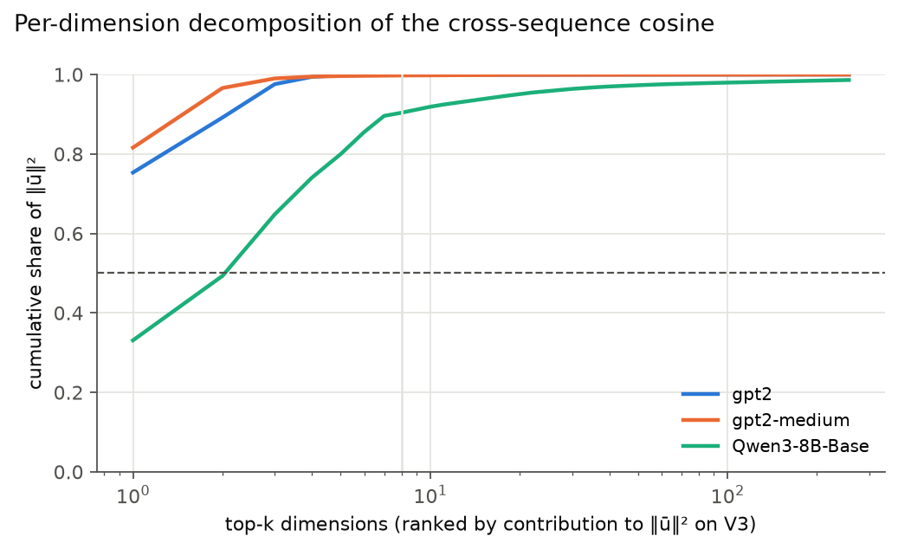

- ‖ū‖² 精确分解：GPT-2 small 前 1 维（496）贡献 75%，前 4 维 99%；gpt2-medium 前 1 维 82%；Qwen3-8B-Base 分布更开：前 1 维 33%，前 8 维 90%。
- 前 8 维占比 > 0.5 的还有 Qwen2.5-7B-Instruct（0.84）、Qwen3-8B（0.88）、Qwen3-32B（0.82）、Mistral（0.66），但它们的 ‖ū‖² 本身较小（0.27 – 0.54）。即"集中在少数维度"不是各向异性模型特有的，各向异性的大小来自这些维度上均值的绝对大小。GPT-2 large/xl、Llama 两个版本、Olmo 的前 8 维只占 15% – 41%。
- 近似公式 Σm²/Σ(m²+s²) 与精确值的误差为 −0.035 – +0.018；在 GPT-2 small/medium 上偏低约 0.035（这两个模型的 token 范数差异较大，近似公式假设范数近似相同）。
- **循环论证检查**：在乘 γ 之前的 V1 中，V3 前 10 维的均值占比 μ²/(μ²+σ²) 在所有 12 个模型里都位于第 97.8 – 99.9 百分位（中位数），也就是说这些维度在残差流里本来就是均值主导的维度。γ 的作用因模型而异：GPT-2 small/medium、Qwen 系列、Mistral 中这些维度的 |γ| 也位于第 98.7 – 99.8 百分位（放大）；Llama 两个版本和 gpt2-xl 中只在第 2.7 – 4.4 百分位（压低）。在 GPT-2 small 中，V3 前 10 维只占 V1 的 ‖ū‖² 的 28%（与 V1 自己的前 10 维重合 3 个），γ 把锥集中到了这几维上；在 Qwen3-8B-Base 中，同样的 10 维已占 V1 的 54%（重合 8 个）。
- **base→instruct 反事实**：把 Qwen3-8B-Base 的 V1 在前 k 维的均值平移到 Qwen3-8B 的值（γ 用 base 的），预测余弦从 0.847 降到 0.788（k=1）、0.655（k=4）、0.553（k=8，弥合 97%）、0.519（k=16，超过 instruct 的 0.542）。Llama 对照：差距小且方向相反，k=16 也只弥合 25%。

### R3.3 功能性干预（步骤 3）

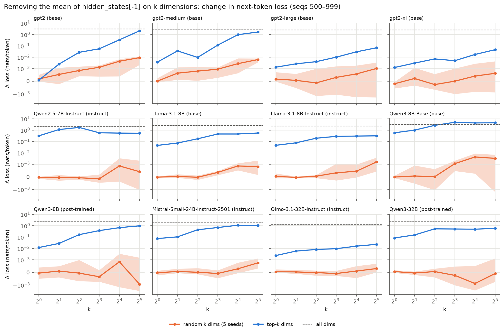

前 500 条序列估计 `hidden_states[-1]` 的各维均值 m（剔除位置 0），在后 500 条（各 tokenizer 9.0 万 – 9.5 万个预测 token）上评估 next-token loss。由于 `logits' = logits − W_U[:,S] m_S`，去掉均值在功能上只等价于一个固定的 logit 偏置，不携带随 token 变化的信息；本节测的是这个偏置有多重要。

| model | 基线 loss | 前 1 维 | 前 8 维 | 前 32 维 | 全部维度 | 可加占比（前 1 / 8 / 32 维） |
|---|---|---|---|---|---|---|
| gpt2 | 3.775 | +0.0001 | +0.056 | +2.128 | +3.113 | 0.05 / 0.33 / 0.82 |
| gpt2-medium | 3.460 | +0.004 | +0.118 | +1.687 | +2.973 | 0.03 / 0.36 / 0.74 |
| gpt2-large | 3.310 | +0.001 | +0.010 | +0.069 | +2.568 | 0.02 / 0.05 / 0.14 |
| gpt2-xl | 3.220 | +0.001 | +0.005 | +0.047 | +2.512 | 0.01 / 0.04 / 0.12 |
| Qwen2.5-7B-Instruct | 2.509 | +0.318 | +0.586 | +0.538 | +2.121 | 0.37 / 0.85 / 0.69 |
| Llama-3.1-8B | 2.351 | +0.046 | +0.460 | +0.562 | +2.582 | 0.18 / 0.50 / 0.62 |
| Llama-3.1-8B-Instruct | 2.461 | +0.047 | +0.285 | +0.316 | +2.301 | 0.20 / 0.49 / 0.44 |
| Qwen3-8B-Base | 2.444 | +0.587 | **+4.956** | +4.480 | +3.131 | 0.06 / 0.98 / 1.20 |
| Qwen3-8B | 2.909 | +0.012 | +0.376 | +0.989 | +2.438 | 0.08 / 0.71 / 0.93 |
| Mistral-Small-24B | 2.257 | +0.075 | +0.701 | +1.068 | +2.093 | 0.22 / 0.70 / 0.86 |
| Olmo-3.1-32B | 2.792 | +0.002 | +0.010 | +0.023 | +1.269 | 0.00 / 0.05 / 0.15 |
| Qwen3-32B | 2.687 | +0.085 | +0.519 | +0.596 | +2.459 | 0.45 / 0.13 / 0.13 |

（Δloss 单位 nats/token。可加占比 = Cov(δ_S, δ_all) / Var(δ_all)，其中 δ_S = W_U[:,S] m_S 为去掉前 k 维均值造成的 logit 偏移，δ_all 为去掉全部维度的偏移，在出现 ≥ 5 次的 token 上计算；它是前 k 维在 δ_all 的词表离散程度中所占的份额，前 k 维与其余维度的份额之和为 1，> 1 表示其余维度在抵消前 k 维。随机对照（从非前 32 维中随机抽 k 维，5 个 seed）与"前 k 维 Δloss ÷ 随机最大 \|Δloss\|"的倍数见 `results/round3/summary.md` 和图中阴影；k ≥ 2 时 12 个模型的前 k 维都超过随机最大值，2× – 7900×。）

- 去掉**全部维度**的均值在所有 12 个模型上都使 loss 增加 1.27 – 3.13 nats/token，包括最后一层各向同性的模型（Olmo +1.27，gpt2-large +2.57）。均值偏置在每个模型里都承担着重要的输出先验，与锥的宽窄无关。
- 去掉**前 k 维**：Qwen3-8B-Base、Qwen2.5、Mistral、Qwen3-32B、Llama、Qwen3-8B 在 k ≤ 8 时就有 0.28 – 4.96 nats 的增加（bite）；GPT-2 large/xl 和 Olmo 在 k ≤ 32 时 ≤ 0.07 nats（在这些模型里，均值偏置分散在很多维度上，前几维不重要）。
- **余弦贡献与功能重要性可以分离**：GPT-2 small 的第 496 维贡献了 75% 的 ‖ū‖²，但去掉它的均值只增加 0.0001 nats。原因是它造成的 logit 偏移几乎是常数：在出现 ≥ 5 次的 token 上，偏移的 |均值| = 41.3，标准差只有 0.15，而 softmax 对常数偏移不敏感。全部 84 个"模型 × 维度集合"组合上，Spearman(偏移在词表上的标准差, Δloss) = 0.95。**这是对 softmax 平移不变性的一致性检查，不是独立发现：** 常数偏移不改变 loss，Δloss 只能来自偏移在词表上的差异，所以两者高度相关是预期之中的。它说明的是：决定功能代价的是偏移在词表上的**差异**，而不是该维度对余弦的贡献。
- 去掉第 496 维均值的可加占比只有 0.05（R3.6），即它在完整均值偏置 δ_all 的词表差异中几乎不起作用。

#### 抵消检查（补充）

δ_S = 去掉前 k 维均值造成的偏移，δ_R = δ_all − δ_S 为其余维度的偏移；在出现 ≥ 5 次的 token 上计算（完整表含 sd(δ_S)、sd(δ_R)，见 `results/round3/followup.md`）。

| model | sd(δ_all) | corr(δ_S, δ_R)：k=1 / 2 / 4 / 8 / 16 / 32 | sd(δ_S) / sd(δ_R)，k=8 |
|---|---|---|---|
| gpt2 | 1.96 | +0.60 / +0.62 / +0.42 / +0.40 / +0.61 / +0.38 | 0.88 / 1.43 |
| gpt2-medium | 1.99 | +0.55 / +0.37 / +0.52 / +0.55 / +0.55 / +0.55 | 0.87 / 1.37 |
| gpt2-large | 1.81 | +0.41 / +0.27 / +0.15 / +0.26 / +0.43 / +0.56 | 0.22 / 1.74 |
| gpt2-xl | 1.76 | +0.42 / +0.36 / +0.07 / +0.36 / +0.48 / +0.57 | 0.16 / 1.70 |
| Qwen2.5-7B-Instruct | 1.82 | +0.17 / **−0.45 / −0.62** / +0.04 / +0.47 / +0.58 | 1.66 / 0.67 |
| Llama-3.1-8B | 1.71 | +0.76 / +0.64 / +0.68 / +0.73 / +0.68 / +0.65 | 0.92 / 0.92 |
| Llama-3.1-8B-Instruct | 1.48 | +0.72 / +0.58 / +0.53 / +0.50 / +0.41 / +0.33 | 0.84 / 0.87 |
| Qwen3-8B-Base | 2.57 | **−0.31 / −0.31 / −0.41 / −0.55 / −0.65 / −0.70** | 3.08 / 1.80 |
| Qwen3-8B | 2.09 | +0.14 / +0.22 / +0.27 / +0.06 / −0.07 / −0.19 | 1.72 / 1.07 |
| Mistral-Small-24B | 1.41 | +0.40 / +0.47 / +0.52 / +0.45 / +0.17 / +0.28 | 1.05 / 0.57 |
| Olmo-3.1-32B | 0.92 | +0.00 / +0.31 / +0.22 / +0.10 / +0.14 / +0.30 | 0.16 / 0.89 |
| Qwen3-32B | 1.73 | +0.23 / −0.03 / **−0.45 / −0.36 / −0.34 / −0.35** | 1.04 / 1.81 |

- 12 个模型中有 8 个（GPT-2 系列、Llama 两个版本、Mistral、Olmo）在所有 k 上 corr ≥ 0（Olmo k=1 为 +0.003，其余 ≥ +0.07）：前 k 维与其余维度的偏移同向，不存在抵消。
- **Qwen3-8B-Base（改写前文解读）：** 前 8 维的偏移 δ_S（sd 3.08）比完整偏移 δ_all（sd 2.57）更分散。其余 4088 维的偏移 δ_R 并不小（sd 1.80），但与 δ_S 负相关（corr −0.55），抵消了 δ_S 的一部分。可加占比 0.98：δ_all 的词表差异几乎全部由前 8 维承担，其余维度合起来的净份额约为 0，但这是相互抵消的结果，不是它们没有偏移。只去掉前 8 维时这部分抵消也被去掉，减去的偏移 sd 从 2.57 变成 3.08，所以 Δloss（+4.96）超过去掉全部维度（+3.13）。k = 16、32 时可加占比 > 1（1.13、1.20），corr 继续降到 −0.70，Δloss（+4.32、+4.48）仍高于全部维度。因此前文"Qwen3-8B-Base k=8 bite 最大（+4.96）"不应读成这 8 维的均值比全部均值更重要。更准确的说法是：这 8 维承担了几乎全部频率先验的词表差异，另有一部分偏置分散在其余维度上，与它们相互抵消。
- **Qwen2.5：** 抵消只出现在 k = 2、4（corr −0.45、−0.62，可加占比 1.03、1.13），对应 Δloss 在 k=4 时达到峰值 +1.74，k=8 回落到 +0.59（k=8 时 corr 回到 +0.04）。
- **Qwen3-32B：** k ≥ 4 时 corr 为 −0.34 – −0.45，可加占比只有 0.04 – 0.15，但 Δloss 为 0.50 – 0.60，因为 δ_S 自身的 sd 约为 1.0。前 k 维的偏移大部分被其余维度抵消，对 δ_all 的净贡献很小。
- 抵消只出现在 Qwen 家族（3 个模型 + Qwen3-8B 的 k ≥ 16 有弱负相关 −0.07 / −0.19）。是否与 Qwen 的训练或架构有关，本次无法判断。

### R3.4 词频（步骤 3b）

在 wikitext-103 train 的前 9000 万字符（各 tokenizer 约 1970 万 – 2100 万 token，6 组 tokenizer）上统计词频，只用出现 ≥ 5 次的 token（约 4 万种）。
- 去掉全部维度均值造成的 logit 偏移 W_U m 与 log 词频的 Spearman ρ 在 12 个模型上为 0.57 – 0.66（n ≈ 4 万，p 值在浮点精度下为 0）。
- 前 k 维的偏移（12 个模型 × 6 个 k = 72 项）：70 项为正（0.105 – 0.623）；Olmo 前 1 维（−0.038）和 Qwen3-32B 前 4 维（−0.017）接近 0。
- 支持"均值方向编码词频先验"的经典解释，但这一相关在各向同性的模型（Olmo、gpt2-large/xl）上同样存在，因此它解释的是均值偏置的**内容**，而不是为什么有的模型在余弦上表现为窄锥。

### R3.5 对前两轮结论的修改

- 第二轮 3.3"最后一层的离群维度正好就是 |γ| 最大的那几维"：仍然成立，但**补充**：这些维度在乘 γ 之前就已是均值主导的维度（R3.2 循环论证检查），离群是"残差流中的强均值 × γ 放大"共同造成的，而不是只由 γ 造成。
- 第二轮 3.5"最大离群维度（2284）的 mean|h| 从 156 降到 61"作为 Qwen3-8B base→post-trained 差异的解释：**修改为**需要约 8 个维度。只平移这一维只能弥合 19% 的差距，前 8 维弥合 97%（R3.2 反事实）。
- 第二轮 3.1"GPT-2 的分界在 medium 与 large 之间"：**限定为 V3 上的现象**。V1 下 GPT-2 随规模单调、平缓上升（0.153 → 0.212 → 0.297 → 0.318），large/xl 的高 isotropy 来自 γ 对均值维度的压低。
- 第一轮 / 第二轮 3.1"Qwen3-8B-Base 与 GPT-2 small 同一量级（0.137）"：在 V3 上成立；V1 下 Qwen3-8B-Base 为 0.340，与 GPT-2 large/xl（0.30 / 0.32）、Qwen3-8B（0.39）同组，而不是与 GPT-2 small（0.153）同组。
- 第二轮 3.5 base vs post-trained：V1 下两对的差异都只有约 ±0.05（Qwen3 +0.05，Llama −0.05），V3 下 Qwen3 的 +0.27 主要来自 γ 的放大。
- 本轮 R3.3 初稿"Qwen3-8B-Base k=8 的 +4.96 大于去掉全部维度，可能是破坏了相互抵消"：抵消检查证实了这一点（corr −0.55，可加占比 0.98），并据此改写了解读（R3.3 抵消检查）。
- 第一、二轮对各模型 `hidden_states[-1]` isotropy 的跨模型比较：数值本身不变，但**补充前提**：把 γ 折进 LM head 后排序会明显改变（ρ = 0.48，R3.1），这些比较依赖于该表示的尺度约定。

### R3.6 逐维明细（补充）

6 个模型 V3 贡献前 20 维的完整表见 `results/round3/followup.md`，这里只列前 5 维。W_U 从 safetensors 只读 LM head 权重（GPT-2 为 `wte.weight`），按 GPU 任务的做法转成 bf16；由它重建的前 8 维偏移与 GPU 任务保存的偏移相对误差 ≤ 2.9e-7。百分位：均值占比是在 V1 的全部 d 维中，γ 是按 \|γ\| 排。"偏移 sd" = W_U[:,k]·m_k 在出现 ≥ 5 次的 token 上的标准差，"可加占比" = Cov(W_U[:,k] m_k, δ_all) / Var(δ_all)。

| model | 排名 | 维 | ū_k² 占比 | V1 μ²/(μ²+σ²)（百分位） | γ_k（百分位） | 偏移 sd | 可加占比 |
|---|---|---|---|---|---|---|---|
| gpt2 | 1 | 496 | 0.753 | 0.93 (0.991) | +17.38 (1.000) | 0.15 | +0.049 |
|  | 2 | 430 | 0.138 | 0.83 (0.990) | +17.00 (0.999) | 0.10 | +0.025 |
|  | 3 | 36 | 0.084 | 0.81 (0.988) | +13.81 (0.996) | 0.09 | +0.017 |
|  | 4 | 314 | 0.018 | 0.59 (0.982) | +15.31 (0.997) | 0.50 | +0.165 |
|  | 5 | 374 | 0.004 | 0.57 (0.980) | +12.19 (0.993) | 0.14 | −0.010 |
| gpt2-medium | 1 | 909 | 0.816 | 0.64 (0.990) | +19.25 (1.000) | 0.10 | +0.030 |
|  | 2 | 671 | 0.150 | 0.65 (0.992) | +13.56 (0.998) | 0.70 | +0.238 |
|  | 3 | 433 | 0.024 | 0.30 (0.975) | +15.00 (0.999) | 0.10 | −0.023 |
|  | 4 | 649 | 0.004 | 0.31 (0.981) | +12.69 (0.997) | 0.37 | −0.101 |
|  | 5 | 752 | 0.002 | 0.16 (0.892) | +12.56 (0.996) | 0.22 | −0.065 |
| Qwen3-8B-Base | 1 | 2284 | 0.331 | 0.93 (1.000) | +10.38 (1.000) | 1.19 | +0.064 |
|  | 2 | 2109 | 0.162 | 0.94 (1.000) | +4.91 (0.997) | 1.58 | +0.252 |
|  | 3 | 3169 | 0.155 | 0.91 (0.998) | +9.31 (1.000) | 1.60 | +0.303 |
|  | 4 | 2202 | 0.092 | 0.92 (0.999) | +9.38 (1.000) | 1.09 | +0.111 |
|  | 5 | 2652 | 0.059 | 0.94 (1.000) | +5.50 (0.998) | 1.32 | −0.072 |
| Qwen3-8B | 1 | 2284 | 0.279 | 0.82 (0.999) | +10.38 (1.000) | 0.47 | +0.079 |
|  | 2 | 2109 | 0.150 | 0.84 (0.999) | +4.91 (0.997) | 0.63 | +0.144 |
|  | 3 | 2202 | 0.114 | 0.85 (1.000) | +9.38 (1.000) | 0.43 | +0.062 |
|  | 4 | 3169 | 0.097 | 0.68 (0.997) | +9.31 (1.000) | 0.50 | +0.107 |
|  | 5 | 4081 | 0.076 | 0.61 (0.995) | +8.88 (0.999) | 0.53 | +0.201 |
| Llama-3.1-8B | 1 | 1917 | 0.108 | 0.78 (1.000) | +2.08 (0.056) | 0.37 | +0.181 |
|  | 2 | 1753 | 0.095 | 0.79 (1.000) | +2.16 (0.083) | 0.21 | −0.013 |
|  | 3 | 184 | 0.049 | 0.81 (1.000) | +1.47 (0.009) | 0.35 | +0.164 |
|  | 4 | 3928 | 0.046 | 0.67 (0.999) | +1.98 (0.033) | 0.16 | +0.040 |
|  | 5 | 3139 | 0.035 | 0.63 (0.999) | +1.91 (0.028) | 0.18 | +0.065 |
| Olmo-3.1-32B | 1 | 4780 | 0.031 | 0.48 (1.000) | +1.27 (0.989) | 0.05 | +0.003 |
|  | 2 | 1425 | 0.031 | 0.35 (0.999) | +0.91 (0.009) | 0.10 | +0.046 |
|  | 3 | 1891 | 0.021 | 0.18 (0.971) | +1.44 (0.997) | 0.06 | −0.019 |
|  | 4 | 4298 | 0.017 | 0.30 (0.997) | +1.09 (0.140) | 0.05 | +0.022 |
|  | 5 | 863 | 0.015 | 0.28 (0.996) | +0.82 (0.006) | 0.06 | +0.033 |

- **ū_k² 占比与可加占比基本无关。** GPT-2 small 前 3 维占 ‖ū‖² 的 97.5%，可加占比合计只有 0.09；第 4 维（314）只占 1.8%，可加占比却是 0.17，为前 20 维中最大。gpt2-medium 的第 909 维（82%）为 0.03，第 671 维（15%）为 0.24。
- **Qwen3-8B 与 Qwen3-8B-Base** 的前 4 维是同一组维度（2284、2109、3169、2202，排序略有不同），γ 相同。post-trained 版本的 \|m_k\| 约为 base 的 0.33 – 0.47 倍，偏移 sd 也相应变小（如 2284：1.19 → 0.47）。
- **Llama 和 Olmo** 的前 5 维分布平坦（每维 ≤ 11%），Llama 前 5 维的 γ 全部位于 \|γ\| 的低端（百分位 ≤ 0.083）。
- GPT-2 small 前 20 维中的第 15 – 19 名（481、373、64、447、87）在 V1 中均值占比 ≥ 0.93（百分位 ≥ 0.99），但 γ 只有 0.004 – 0.043，在 \|γ\| 中位于最低的 1% 以内。其中 64、373、447、481 正是第一轮中间层的离群维度（结论摘要第 5 条）。gpt2-medium 的 268、580、590、689 同样如此（γ 0.016 – 0.157）。

### R3.7 架构协变量（补充）

来自 config.json 与 checkpoint 的权重名（是否有 `q_norm`、`q_proj.bias` / `c_attn.bias`、`lm_head.bias`，以及第 0 层 norm 的名字）；共享 embedding 与 lm_head bias 取自第三轮 GPU 任务中加载后的模型。

| model | 归一化 | 位置 | QK-norm | 共享 emb | lm_head bias | attention bias | d | 层数 | 词表 | V1 A | V3 A |
|---|---|---|---|---|---|---|---|---|---|---|---|
| gpt2 | LayerNorm（含 β） | pre-norm | 无 | 是 | 无 | 有 | 768 | 12 | 50257 | 0.153 | 0.068 |
| gpt2-medium | LayerNorm（含 β） | pre-norm | 无 | 是 | 无 | 有 | 1024 | 24 | 50257 | 0.212 | 0.319 |
| gpt2-large | LayerNorm（含 β） | pre-norm | 无 | 是 | 无 | 有 | 1280 | 36 | 50257 | 0.297 | 0.708 |
| gpt2-xl | LayerNorm（含 β） | pre-norm | 无 | 是 | 无 | 有 | 1600 | 48 | 50257 | 0.318 | 0.723 |
| Qwen2.5-7B-Instruct | RMSNorm | pre-norm | 无 | 否 | 无 | 有（q/k/v） | 3584 | 28 | 152064 | 0.674 | 0.600 |
| Llama-3.1-8B | RMSNorm | pre-norm | 无 | 否 | 无 | 无 | 4096 | 32 | 128256 | 0.687 | 0.703 |
| Llama-3.1-8B-Instruct | RMSNorm | pre-norm | 无 | 否 | 无 | 无 | 4096 | 32 | 128256 | 0.635 | 0.657 |
| Qwen3-8B-Base | RMSNorm | pre-norm | 有（逐 head） | 否 | 无 | 无 | 4096 | 36 | 151936 | 0.340 | 0.137 |
| Qwen3-8B | RMSNorm | pre-norm | 有（逐 head） | 否 | 无 | 无 | 4096 | 36 | 151936 | 0.391 | 0.403 |
| Mistral-Small-24B | RMSNorm | pre-norm | 无 | 否 | 无 | 无 | 5120 | 40 | 131072 | 0.682 | 0.596 |
| Olmo-3.1-32B | RMSNorm | **post-sublayer**（norm 作用在子层输出上，再加回残差） | 有（整个 q/k 宽度） | 否 | 无 | 无 | 5120 | 64 | 100278 | 0.857 | 0.859 |
| Qwen3-32B | RMSNorm | pre-norm | 有（逐 head） | 否 | 无 | 无 | 5120 | 64 | 151936 | 0.703 | 0.657 |

所有模型都有 final norm，且 12 个模型都没有 lm_head bias。
- V1 下最低的 6 个模型（GPT-2 ×4、Qwen3-8B ×2）分属两种完全不同的配置：LayerNorm + 共享 emb + attention bias，以及 RMSNorm + 逐 head QK-norm + 不共享。与 Qwen3-8B 配置相同的 Qwen3-32B 在 V1 下为 0.703。
- Olmo-3.1 是唯一的 post-sublayer norm 模型，也是 V1、V3 下最各向同性、第一轮中唯一没有位置 0 范数尖峰的模型。只有这一个样本，无法区分是 norm 位置、QK-norm 形式还是训练数据造成的。
- 这些协变量与模型家族、规模、训练数据完全混杂，本表只用于描述，不支持因果推断。

## 第四轮：下游意义（A）与训练动态（B）

Slurm：A 为 array 9802（12 个任务，`%2`，每任务 1 张 B300，`--time=00:40:00`，单任务 6–22 分钟；gpt2 沿用 srun 冒烟测试的完整输出）；B 为 array 9832（7 个任务、91 个 checkpoint，`%2`，单任务 2–5 分钟）。冒烟测试：A 用 srun 跑 gpt2，B 用 srun 跑 pythia-70m 的 step0 与 step143000、OLMo-2 的 main。B 的 checkpoint 在 A 运行期间于登录节点下载，共 233 GB（剩余空间约 39 TB，不需要边跑边删），存放在 `/dataset1/zailong/models/ckpts/<model>/<revision>/`。代码：`prepare_fit_sentences.py`、`sts_round4.py`、`download_round4.py`、`dyn_round4.py`、`analyze_round4.py`；完整数值见 `results/round4/sts_summary.md` 与 `results/round4/dyn_summary.md`。

### R4.0 预期与结果对照

| # | 预期（假设） | 实际结果 | 是否一致 |
|---|---|---|---|
| A1 | zscore 下 V1 与 V3 的 STS 完全相同，差值 < 1e-6 | 第一次实现失败：差值 1.3e-5，修正后仍为 5.1e-6（见 R4.1）。修正后 12 个模型 × 2 种池化 × 2 个数据集的差值全部为 0 | 一致（修正实现之后） |
| A2 | raw 下 12 个模型的 ΔSTS(V1 − V3) 与 (A_V1 − A_V3) 正相关 | ρ = +0.48 / +0.46 / +0.48 / +0.20（STS-B mean / STS-B EOL / SICK-R mean / SICK-R EOL），p = 0.09 – 0.51 | 方向一致，但弱且不显著；gpt2-medium 是明显反例 |
| A2' | （探索性，非预设）ΔSTS 与 γ 对**方差集中度**的影响相关 | ρ(ΔSTS, top1(V3) − top1(V1)) = +0.71 – +0.90，p ≤ 0.002 | — |
| A3 | center 带来大部分提升，并显著缩小 V1/V3 差距 | center 只拿到最佳变体提升的中位数 13%；只在 17/48 个"模型 × 设置"中缩小了差距；在 GPT-2 small/medium、Qwen3-8B(-Base)、Qwen3-32B 的 V3 上 center 反而大幅降低 STS（例如 GPT-2 small STS-B mean 26.3 → 9.3） | 不一致 |
| A4 | abtt-k 在各向同性的模型上可能略降 | 8 个 V3 isotropy ≥ 0.59 的模型 × 4 个设置：abtt-10 相对 raw 和 center 都没有下降（32/32 ≥ 0，中位 +2.6）；abtt-1 偶尔小幅下降（最低 −0.7，相对 center） | 基本不一致（见 R4.6 对照） |
| 0a / 1a | Pythia、OLMo-2 的 hook 与 W_U 读取正确 | 91 个 checkpoint：0a ≤ 1.8e-3；γ 折算最大相对误差 ≤ 3.3e-6，argmax 一致率 ≥ 0.99972 | 一致 |
| B1 | Pythia-410m/1.4b 训练后期 V1 一直偏低，只有 V3 被 γ 拉高；‖β‖ 不是主因 | 训练中段（step 8000 – 80000）成立：V1 降到 0.39 – 0.57，V3 保持 0.62 – 0.66，V3 前 10 维的 \|γ\| 百分位为 0.00 – 0.05。但到最终 checkpoint，V1 回升到 0.52 / 0.54，γ 的作用只剩 +0.03 / +0.05。‖β‖/‖γ‖ 始终 ≤ 0.04，且后期在下降 | 部分一致：中段一致，终点 V1 本身已是中等各向同性 |
| B2 | 70m（和 160m）中，均值维度先在残差流出现（H1）还是 γ 尖峰先出现（H2） | V1 的 ‖ū‖² 从 step 2000 开始持续上升（70m：0.25 → 0.66，step 50000）；同期 γ 压低这些维度（\|γ\| 百分位 0.01 – 0.03，到 step 13000），V3 的 ‖ū‖² 保持 0.24 – 0.39。70m 在 step 32000 时 γ 转为放大（百分位 0.98），晚于残差流均值的出现约 3 万步。γ 始终没有尖峰（max/median ≤ 2.5，GPT-2 small 为 13.9）。最后的坍缩（70m 在 step 80000 – 143000，160m 在 110000 – 143000）主要发生在 V1 本身 | 支持 H1，H2 不成立；但最终的各向异性来自残差流，不是 γ 放大 |
| B3 | 是否出现类似 GPT-2 small 第 496 维的"bark"维度 | 按预先写在代码里的标准（‖ū‖² 占比 ≥ 0.3、\|可加占比\| < 0.05、偏移 sd/\|均值\| < 0.05），91 个 checkpoint 中都没有。最接近的是 70m step 80000 的第 169 维（占比 0.28、可加占比 +0.009，但 sd/\|均值\| = 0.21） | 未出现 |
| B4 | massive activation 出现后，其维度的 \|γ\| 百分位下降，且压制滞后于出现 | 中间/后部层的 massive 维度：\|γ\| 百分位降到 ≤ 0.05 与比值上升同时或更早（step 1000 – 8000），看不到滞后。前部层（第 2 – 3 层）的 massive 维度没有被压低（百分位约 0.5） | 下降成立；"滞后"在本次 checkpoint 分辨率下不成立 |
| B5 | 是否出现 Qwen 式抵消（corr(δ_S, δ_R) < 0 且子集 Δloss > 全部） | 训练过的 checkpoint 中只出现一次：pythia-70m step 110000，k=16。step 0 – 4 也被标记，但那时所有 Δloss ≈ 0（−0.1 – 0），无意义 | 基本未出现 |
| B6 | 若 Olmo-3.1 无位置 0 尖峰是架构造成的，OLMo-2-1B 全程比值 < 5 | OLMo-2 全部 15 个 checkpoint 的最大比值 ≤ 2.9。Pythia 四个规模在 step 3000 – 13000 之后都超过 5，最终为 10.6 – 47.5 | 一致（与架构解释相容，但不构成证明） |

### R4.1 A 的设置与 A1 的实现修正

- **句向量。** 每个句子单独前向（batch 1），`add_special_tokens=True`。mean 池化取最后一层除位置 0 以外的平均；PromptEOL 用模板 `This sentence : "[X]" means in one word:"` 取最后一个 token。V1 先在 token 级计算（round3_lib 的 `variants`），再池化。
- **拟合集。** `data/fit_sentences.jsonl` 是从 `data/samples.jsonl` 中按 WikiText 的 " ." 切出的 2000 个句子（6 – 50 词，seed 0）。还原了 ` @-@ `、` , ` 等分词痕迹，使其形式接近 STS 文本。center / zscore / abtt-k 的均值、标准差和主成分都只在这 2000 句上估计。
- **数据集。** STS-B test（1379 对，`sentence-transformers/stsb`）和 SICK-R test（9927 对，`mteb/sickr-sts`）；两个数据集名称和 split 都存在。
- **A1 的两次失败与修正。** 第一版 V3 用 fp32 计算（γ⊙V1+β），A1 差值为 1.3e-5。改为 fp64 计算 V3 后仍为 5.1e-6，原因是 V1 的池化仍在 fp32 里做。两处都改为 fp64 后，所有设置的差值都为 0。原因：GPT-2 第 496 维这类均值维度的值约为 200，波动只有约 0.5；fp32 的舍入误差在 zscore 去均值之后被放大到约 1e-5。这是数值精度问题，不是逻辑错误。两次失败的输出保存在 `results/round4/sts/gpt2_fp32*_A1fail.json`。
- **V3 的来源。** V3 用的是 fp64 重建的 γ⊙V1+β，而不是 bf16 的 `hidden_states[-1]`。两者在 raw 下的 STS 差别 ≤ 0.06（`sts_summary.md` 的 Checks 表）。

### R4.2 A 的结果

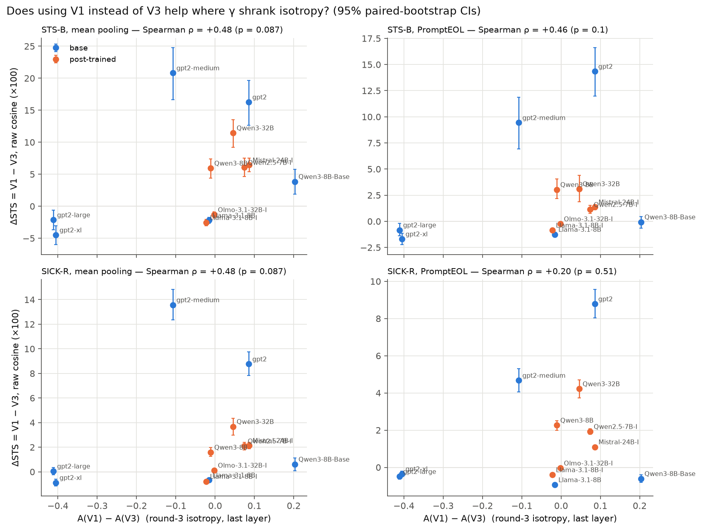

STS-B（×100）中 raw V3 → raw V1 → 6 种变体中 V3 的最佳值：

| model | mean 池化 | PromptEOL |
|---|---|---|
| gpt2 | 26.3 → 42.6 → 47.3 | 53.0 → 67.3 → 71.0 |
| gpt2-medium | 17.2 → 38.0 → 50.6 | 46.8 → 56.2 → 65.0 |
| gpt2-large | 46.0 → 43.9 → 51.7 | 70.1 → 69.2 → 72.5 |
| gpt2-xl | 47.3 → 42.8 → 52.5 | 66.7 → 65.1 → 70.6 |
| Qwen2.5-7B-Instruct | 37.5 → 43.6 → 52.1 | 74.0 → 75.1 → 75.1 |
| Llama-3.1-8B | 45.8 → 43.6 → 50.0 | 72.1 → 70.9 → 74.6 |
| Llama-3.1-8B-Instruct | 48.0 → 45.4 → 52.9 | 74.3 → 73.4 → 75.5 |
| Qwen3-8B-Base | 30.9 → 34.7 → 44.3 | 72.1 → 72.1 → 72.1 |
| Qwen3-8B | 29.4 → 35.4 → 49.1 | 69.7 → 72.7 → 73.0 |
| Mistral-Small-24B | 39.7 → 46.1 → 51.9 | 72.0 → 73.3 → 73.4 |
| Olmo-3.1-32B | 47.2 → 45.9 → 56.8 | 68.9 → 68.6 → 69.1 |
| Qwen3-32B | 28.9 → 40.3 → 48.4 | 68.4 → 71.5 → 73.2 |

- **V1 − V3（raw）。** γ 放大均值维度的模型（GPT-2 small/medium、Qwen 系列、Mistral）用 V1 更好：STS-B mean 上 +3.8 到 +20.8，95% CI 都不含 0。γ 压低均值维度的模型（gpt2-large/xl、Llama 两个版本）用 V1 更差：−2.1 到 −4.5。Olmo 为 −1.3。
- **A2 的反例。** gpt2-medium 的 A_V1 − A_V3 = −0.11（γ 提高了 isotropy），但 V1 在 STS 上反而好得多（STS-B mean +20.8）。原因是它的 V3 中方差几乎全部集中在一维（round 3：top-1 方差占比 0.92）。这种集中不体现在 isotropy A（均值方向）上，却直接损害余弦。按方差集中度的变化排序（A2'），12 个模型的相关为 ρ = 0.71 – 0.90。即 γ 对 STS 的影响主要通过方差集中度，而不是通过均值方向。这一分析是看到 A2 结果之后补做的，不是预设假设。
- **最佳变体。** 48 个"模型 × 设置"中，V3 的最佳变体在 47 个里是 zscore 或 abtt-10，例外是 Qwen3-8B-Base 的 STS-B EOL（raw 最好）。zscore 消去了 γ 和 β（A1），所以"用 V1 还是 V3"的差别在 zscore 下完全消失。
- **A3 不成立。** 只做 center 在多数情况下帮助很小（中位数只拿到最佳提升的 13%）。在方差高度集中的 V3 上，center 会大幅变差（GPT-2 small STS-B mean 26.3 → 9.3，gpt2-medium 17.2 → 3.5）：去掉均值之后，余弦几乎只由一两个 γ 放大的高方差维度决定。
- **层扫描（只对原始 `hidden_states[l]`，raw 与 center）。** 中间层没有 γ，所以"V1 vs V3"只在最后一层有定义，扫描回答的是"最后一层是不是最好的层"。PromptEOL 下最好的 block 都在最后 4 个 block 内。最后一层 V1 与最好 block 之差为 −2.2 到 +4.7：gpt2 的 V1 比任何 block 都好；Llama-3.1-8B 差距最大（STS-B 最好 73.6，V1 68.9）；Qwen3-32B 为 73.0 vs V1 71.5，V3 65.4。mean 池化下，最好的往往是前部或中部 block，或 embedding 层（Olmo embedding 66.4 > 最后一层 49.5），最后一层并不是 mean 池化的好选择。

### R4.3 B 的设置与架构核对

- **Pythia（GPT-NeoX）。** LayerNorm（含 β），pre-norm，attention 与 MLP 并行残差（`use_parallel_residual=True`），无 QK-norm，不共享 embedding（`tie_word_embeddings=False`，加载后 head 与输入 embedding 不是同一张量）。final norm 为 `gpt_neox.final_layer_norm`（已加入 `measure.final_norm_module` 的候选名）。**输出头在 transformers 5.16 中名为 `lm_head`**：checkpoint 里的 `embed_out.*` 在加载时被 `conversion_mapping` 重命名，所以任务书预期的 `embed_out` 以实际代码为准，W_U 统一用 `get_output_embeddings()` 读取。词表行数 50304，tokenizer 为 50277，多出的是填充行，偏移统计只用前 50277 行。tokenizer 不加 BOS，位置 0 是普通文本 token。
- **OLMo-2-0425-1B。** RMSNorm（无 β），post-sublayer norm（`post_attention_layernorm` / `post_feedforward_layernorm` 作用在子层输出上，再加回残差），QK-norm 作用在整个 q/k 宽度上，不共享 embedding，final norm 为 `model.norm`，head 为 `lm_head`，不加 BOS。checkpoint 用 stage1 的 14 个 branch，按 token 数近似对数均匀选取，加上 main。stage1 在 step 300 与 10000 之间没有可用的 branch。main 是 stage2 三个 ingredient 合并后的最终模型，图中画在 4052B token 处。
- **每个 checkpoint 的测量。** 与第三轮相同的 1000 条序列、bank 位置和估计/评估划分（前 500 条估计均值，后 500 条评估）。偏移 δ 的统计用整个词表，不按词频加权（与第三轮的"出现 ≥ 5 次"不同）。
- **step 0 的 γ 百分位。** step 0 时 γ 全为 1，百分位按平均秩计算，所有维度都是 0.5。

### R4.4 B 的结果

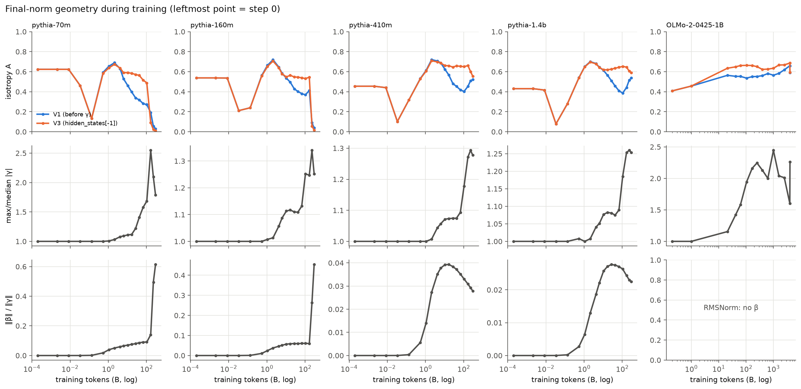

任务书要求把 \|γ\| 尖峰度和 ‖β‖/‖γ‖ 叠加在 isotropy 图上；这里改为共享横轴的三行小图，避免双纵轴。

- **早期瞬态。** 所有 Pythia 在 step 16 – 64 有一次短暂的强各向异性：70m 的 A 降到 0.13，410m 降到 0.10，1.4b 降到 0.08，‖ū‖² 达到 0.87 – 0.91。到 step 1000 恢复到 0.69 – 0.72，此时 γ 仍为 1（V1 = V3）。这一阶段与 γ、β 无关。
- **Pythia-70m / 160m（最终各向异性）。** V1 从 step 1000 – 2000 起持续下降（70m：0.69 → 0.27，step 50000）。V3 被 γ 托在 0.49 – 0.64：V3 前 10 维的 \|γ\| 百分位在 70m 的 step 2000 – 13000、160m 的 step 2000 – 80000 期间为 0.01 – 0.14（偶尔 0.37），即 γ 在压低这些维度。70m 从 step 32000 起这一百分位变为 0.98，γ 转为放大，但此时 V3 仍高于 V1（0.52 vs 0.28）。随后两者一起坍缩：70m 在 step 80000 – 143000 降到 V1 0.031 / V3 0.011，160m 在 step 110000 – 143000 降到 0.038 / 0.018。最终 checkpoint 的分解：
  - 70m 的 V1 已有 ‖ū‖² = 0.963，乘 γ 后为 0.968，再加 β 后为 0.987。去掉 β 后 isotropy 只从 0.011 变到 0.026。
  - 160m 为 0.957 → 0.958 → 0.980。
  - 也就是说，最终的各向异性几乎全部已经在残差流中，γ 与 β 只是略有加强。
  - ‖β‖/‖γ‖ 在坍缩的同时从 0.09 / 0.06 跳到 0.61 / 0.45，两者同时发生。
  - 坍缩后均值不再集中在少数维度（前 10 维只占 ‖ū‖² 的 3 – 9%），RankMe 仍有 0.88：这是一个分布在很多维度上的公共方向，不是低秩。
  - 70m 和 160m 的评估 loss 在坍缩期间都上升了（70m 4.338 → 4.502，160m 3.756 → 3.883）。
- **Pythia-410m / 1.4b（最终各向同性）。** 前段与小模型相同。从 step 3000 – 5000 起，V1 下降（1.4b 最低 0.386，step 50000），V3 被 γ 托在 0.60 – 0.66，V3 前 10 维的 \|γ\| 百分位为 0.00 – 0.01。step 80000 以后 V1 回升（1.4b 0.537，410m 0.522），差距缩小到 +0.03 – +0.05。‖β‖/‖γ‖ 全程 ≤ 0.039，最后阶段在下降。γ 的 max/median 也只有 1.3。
- **OLMo-2-1B。** V1 0.54 – 0.66，V3 0.59 – 0.69，stage1 中 γ 把 isotropy 提高 0.03 – 0.13；main（stage2 之后）的 V1 / V3 为 0.591 / 0.593，几乎相同。没有小 Pythia 那样的坍缩。

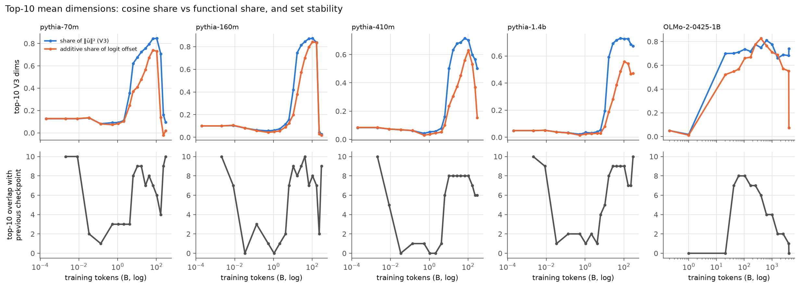

- **承载均值的维度何时稳定。** 前 10 维集合在相邻 checkpoint 之间的重合数，在 Pythia 中 step 3000 之前多为 0 – 3（还没有固定的均值维度），step 5000 – 8000 之后多为 6 – 10。70m/160m 在后期坍缩时又重新洗牌（70m step 80000 时为 4，160m step 110000 时为 2）。OLMo-2 在 stage1 后段的重合数下降到 1 – 4，main 与 stage1 末尾的重合为 0：stage2 训练改变了承载均值的维度。
- **余弦占比与功能占比。** 前 10 维的 ‖ū‖² 占比与可加功能占比在 Pythia 中段大致同步上升（例如 1.4b step 50000：0.73 vs 0.56）。在 70m/160m 坍缩后两者都降到 ≤ 0.09。B3 的"bark"维度（占比高、功能 ≈ 0、偏移近似常数）在 91 个 checkpoint 中都没有出现。最接近的是 70m step 80000 的第 169 维（占比 0.28、可加占比 +0.009，偏移 sd/\|均值\| = 0.21，不是常数），以及 410m 后期的第 180 维（占比 0.12 – 0.16、可加占比 +0.007，sd/\|均值\| ≈ 1）。Pythia 不共享 embedding，这说明 GPT-2 第 496 维那样几乎常数的 W_U 列在 Pythia 的输出头中没有出现。

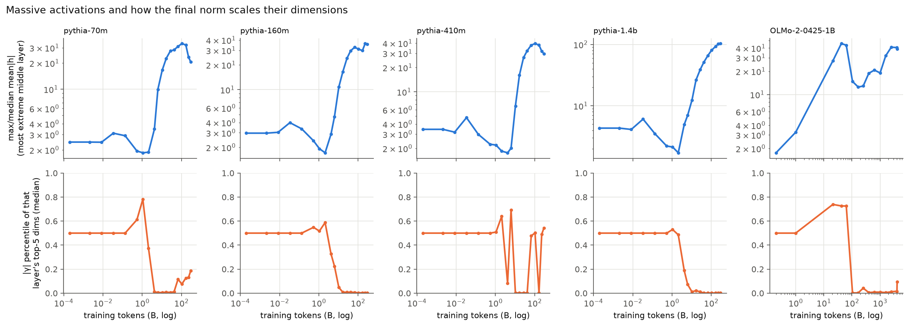

- **Massive activation 与 γ。** 中间层的 max/median mean\|h\| 在 step 2000 之前 ≤ 6；step 3000 – 8000 之间迅速上升，最终为 21 – 103（1.4b 单调上升到 103）。
  - 对应维度的 \|γ\| 百分位从 0.5 降到 ≤ 0.05，与比值上升同时或更早：70m 在 step 1000 – 2000（比值此时只有 3，step 3000 才升到 10），160m 在 3000 – 8000，1.4b 在 2000 – 5000。之后多数时间保持在 0.00 – 0.02。
  - 本次 checkpoint 间隔（1000 – 3000 step）下看不出"先出现、后压制"的滞后。
  - 例外是前部层（第 2 – 3 层）的 massive 维度：410m 在 step 32000 – 50000 和 110000 – 143000 时最极端的层是第 3 层，其维度的 \|γ\| 百分位约 0.5，没有被压低。
  - 注意本指标是"各维 mean\|h\|（对 token 平均）的 max/median"，与 Gallego-Feliciano 等的"单个激活的 max/median"不同，数值不可直接比较（他们报告 Pythia-1.4B 约 2350）。

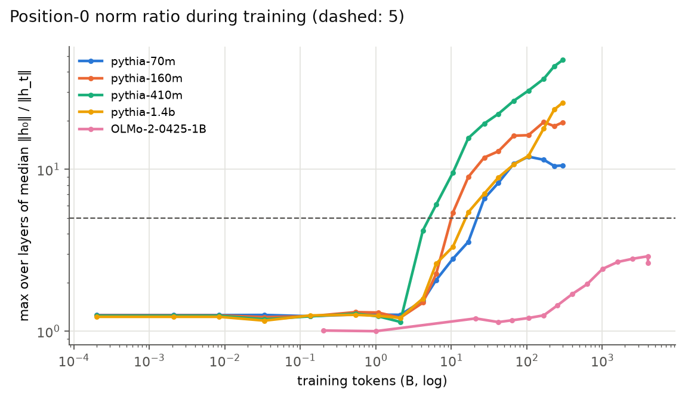

- **位置 0 范数比（B6）。** Pythia 四个规模在 step 2000 之前都是 1.1 – 1.3，在 step 3000（410m）到 13000（70m）之间超过 5，最终为 10.6（70m）、19.5（160m）、47.5（410m）、25.9（1.4b）。OLMo-2 全程 ≤ 2.9，main 为 2.6。与 Olmo-3.1-32B（第 1 轮：≤ 1.7）一致。OLMo-2 的中间层 max/median mean\|h\| 仍有 12 – 46：它有离群维度，只是没有位置 0 的范数尖峰。

### R4.5 抵消（B5）

- 训练过的 checkpoint 中，Qwen 式抵消（存在 k 使 corr(δ_S, δ_R) < 0 且子集 Δloss > 全部维度 Δloss）只在 pythia-70m step 110000（k=16）出现。
- 70m step 80000 所有 k 的 corr 为 −0.24 – −0.32，但子集 Δloss 都小于全部维度。
- 70m step 143000 的前 16 / 32 维 Δloss（4.54 / 7.92）大于全部维度（3.16），但 corr 为正（+0.47 / +0.65）。这里的 corr 是在整个词表上不加权计算的，而 Δloss 由高频 token 主导，所以两者不必一致。这是本轮统计口径（整个词表）与第三轮（出现 ≥ 5 次的 token）不同带来的限制。
- 410m 与 OLMo-2 训练后期的 corr 最低为 −0.11 – −0.18，1.4b 从 step 2000 起全程 ≥ +0.17。三者都没有子集 Δloss 超过全部维度的情况。

### R4.6 与已有工作的对照

- **Machina & Mercer 2024（*Anisotropy is Not Inherent to Transformers*，NAACL）。** 他们在 final LayerNorm **之后**测 Inter-/Intra-Sim，并用配分函数估计 embedding / unembedding 矩阵的各向同性。他们报告 Pythia 70M、160M 最终各向异性、≥ 410M 各向同性；70M 先变得更各向同性，约训练三分之一后出现"runaway"各向异性。各向同性模型的 LN 偏置 b 保持很小、增益 g 持续增大，70M 中两者都增大并伴随各向同性下降；他们明确只作相关性陈述。
  - **一致：** 最终的大小划分相同（V3：70m 0.011、160m 0.018，410m 0.555、1.4b 0.591）。70m 也有"先上升、后坍缩"的轨迹，坍缩发生在 step 50000 – 80000（训练的 35% – 56%）。‖β‖/‖γ‖ 的规律也相同：大模型 ≤ 0.04，小模型在坍缩时跳到 0.45 – 0.61。
  - **补充 / 部分矛盾：** 我们把 final norm 拆成 V1 → γ → β 后，70m/160m 最终的各向异性在 V1（norm 之前，只归一化）中已经达到 ‖ū‖² 0.96。去掉 β 只让 ‖ū‖² 从 0.987 降到 0.968。β 的增大与坍缩同时发生，但不是坍缩的主要来源，来源是残差流本身。
  - **"大模型把 final LN 优化成各向同性"：** 在 410m/1.4b 的训练中段成立，形式是 γ 压低均值维度（step 8000 – 80000 时 V3 比 V1 高 0.06 – 0.27），而不是保持 β 小（β 一直很小，对两者都一样）。到最终 checkpoint，残差流本身已回到中等各向同性（V1 0.52 / 0.54），γ 的贡献只剩 +0.03 / +0.05。
- **Gallego-Feliciano et al. 2025（*Hidden Dynamics of Massive Activations in Transformer Training*）。** 他们用 Pythia 全系列检查点，按层测"最大激活 / 中位激活"，报告 massive activation 在初始化时不存在、在前约 6 万 step 内出现；早/晚层先达到峰值再衰减，中间层呈对数式增长，到 143k 仍未饱和；没有追踪具体维度，也没有分析 final norm。
  - **一致：** 初始化时不存在；在训练早期（我们看到在 step 3000 – 8000 迅速上升）出现；1.4b 的最大值持续上升到 143k。
  - **补充：** 承载 massive activation 的维度在 final norm 中的 \|γ\| 几乎立即被压到最低几个百分位（在同一批 checkpoint 中），而且这些维度与最后一层的均值维度基本不重合（第三轮结论摘要第 5 条）。他们的指标与我们的数值尺度不同，量级不可比。
- **Parupudi 2026（arXiv 2606.29571，*Anisotropy Decides Cosine vs. Rank Metrics for Text Embeddings*）。** 19 个编码器（含 GPT-2、Qwen2.5、Pythia-410M、Mistral-7B），STS-B / SICK-R / STS16。他们的诊断量"单一最大方差坐标的方差占比"可以预测 rank / L1 类指标相对余弦的增益（ρ = 0.86）。去掉前 10 个主方向能在拥挤编码器上恢复余弦，但在分布均匀的编码器上使余弦平均下降 0.014。
  - **一致 / 补充：** 我们的 A2' 发现 ΔSTS(V1 − V3) 主要随 γ 对 top-1 方差占比的改变而变化（ρ = 0.71 – 0.90），与他们"方差集中度决定余弦好坏"的结论一致。我们补充的是：同一个模型在输出完全不变的 γ 折算下，方差集中度和 STS 都会大幅改变（GPT-2 small STS-B mean 26.3 vs 42.6）。所以"编码器的几何"依赖于取哪一个等价表示。
  - **不一致（A4）：** 在我们 8 个 V3 isotropy ≥ 0.59 的 LLM 上，abtt-10 从不降低 STS（32/32 ≥ 0，中位数 +2.6）。可能的原因是两边的"各向同性"不是同一组模型：他们的"分布均匀"组主要是经过对比训练的句向量模型，而我们的 LLM 即使 isotropy 高，方差也仍较集中（第三轮 V3 top-1 方差 0.02 – 0.34）。本次没有计算他们的诊断量，无法直接对齐分组。

## 第五轮：A2' 的样本外检验、与"饱和"的联系、早期 unigram 阶段

所有检验都先写入 `configs/round5_prereg.md` 并 commit（`5ba94c7`，任何第五轮数据分析之前）。实现时发现四处操作化需要定义（置换 p 的单/双侧、Q2-2 的时间窗、Q2-4 的 δ 集合、第 3 项的跨规模判定与"明显下降"的阈值），向用户确认后作为单独的 commit 记录（`7c8c52e`），定义本身未改动。`analyze_round5.py` 只执行预登记的检验，其余内容放在 R5.5"探索性"。

Slurm：
- 第 1 项为 array 9846（5 个任务、59 个 checkpoint）。
- 第 2、3 项为 array 9886（10 个任务、296 行：208 个新 checkpoint 的完整测量 + 前向，76 个第四轮 Pythia checkpoint 只做前向，第三轮 12 个模型只做前向）。
- CPU 任务（无 `--gres`）：9851（Pythia 词频）、9889 / 9908（W_U 谱与对齐）。

全部 COMPLETED。冒烟测试：
- 第 1 项：pythia-410m step 143000，A1 = 0。
- 第 2 项：pythia-70m step 51000。Var 公式与逐位置直接求和的相对差 ≤ 2e-6，前向 loss 与 dyn 的 loss_base 一致到 5e-8。

新增 208 个 Pythia checkpoint（加密窗口 + step 2/8/32/128），约 210 GB。下载中途两次停滞（与第四轮相同），关掉 huggingface_hub 的 Xet 后端（`HF_HUB_DISABLE_XET=1`）后恢复。

代码：`round5_gpu.py`、`round5_cpu.py`、`analyze_round5.py`；`sts_round4.py` 只加了 `--variants`、`--no_layers`、`--out_name` 三个开关，计算不变。数值见 `results/round5/summary.md` 与 `analysis.json`。

### R5.0 预登记预测与结果

| # | 预登记预测 | 实际结果 | 是否一致 |
|---|---|---|---|
| A1 | 59 个 checkpoint 上 zscore 下 V1 − V3 = 0 | 全部为 0 | 一致 |
| P1-1 | 5 个模型的平均 ρ(ΔSTS, Δtop1) > 0，分层置换检验单侧 p < 0.05 | 平均 ρ = +0.678（70m +0.80，160m +0.88，410m +0.68，1.4b +0.76，OLMo-2 +0.26）；p = 0.0001（10000 次置换中没有一次 ≥ 观测值） | 一致 |
| P1-2 | ≥ 4 个模型上 \|ρ(ΔSTS, Δtop1)\| > \|ρ(ΔSTS, A_V1 − A_V3)\| | 只有 1/5（70m：0.80 vs 0.67）；其余 4 个模型 A 差值的 ρ 更大（160m 0.97，410m 0.80，1.4b 0.87，OLMo-2 0.70） | 不一致 |
| Q2-1 | t50 的先后（不预设方向） | 70m：V1 ‖ū‖² 87000 < W_U σ₁²/Σσ² 93000 < ‖β‖/‖γ‖ 95000；160m：96000 < 104000 < 110000。两者相差 6000 / 8000 step，超过 1000 step 的分辨率 | H-rep（残差流坍缩先于头部谱尖峰） |
| Q2-2 | 70m/160m 坍缩后两种 \|cos\| > 0.5；410m/1.4b 同期 < 0.2 | 70m：0.86 – 1.00（57 个 checkpoint），160m：0.95 – 1.00（48 个），1.4b：0.06 – 0.18。410m 在 step ≥ 87000 的 29 个 checkpoint 中有 2 个超过 0.2（step 88000 为 0.228，90000 为 0.219），之后降到 0.00 – 0.19 | 不一致（只因 410m 的两个点越过 0.2；70m/160m 的部分完全成立） |
| Q2-3 | 410m 窗口内 loss 上升，但 V1 isotropy 始终 ≥ 0.4 | loss 最小 3.3371，终点 3.3476（+0.0105）；V1 isotropy 最小 0.454 | 按定义一致，但上升幅度在 checkpoint 间波动（3.337 – 3.372）之内，见 R5.2 |
| Q2-4 | Spearman(½·E_t Var_p(δ), Δloss) > 0.95；70m step 143000 的矛盾消失 | ρ = 0.987（1184 个点：284 个 Pythia checkpoint + 12 个第三轮模型，× 4 个 δ 集合）；同一样本上"词表 sd"为 0.943。70m step 143000：预测量 top32 = 9.80 > all = 2.97（实际 7.92 > 3.16） | 一致 |
| P3-1 | A 最小值、S_const 最大值、ρ(W_U m, log 词频) 最大值在同一或相邻 checkpoint | A 最小与 S_const 最大在 4 个规模上都重合或相邻（step 16 – 64），但词频相关的最大值在 4 个规模上都是 step 512 | 不一致（0/4） |
| P3-2 | A 最小的 checkpoint 上 \|loss − H_uni\| 最小 | 4 个规模的 \|loss − H_uni\| 都在 step 256 最小；A 最小时 loss 仍比 H_uni 高 2.1 – 2.5 nats | 不一致（0/4） |
| P3-3 | S_const(1000) ≤ 0.5 × 最大值，且 A(1000) − min A ≥ 0.2 | 比值 0.544 / 0.485 / 0.495 / 0.502（70m / 160m / 410m / 1.4b），A 回升 0.54 – 0.63 | 不一致（2/4；两个规模以 0.002 和 0.044 的差距未过阈值） |

### R5.1 第 1 项：A2' 的样本外检验

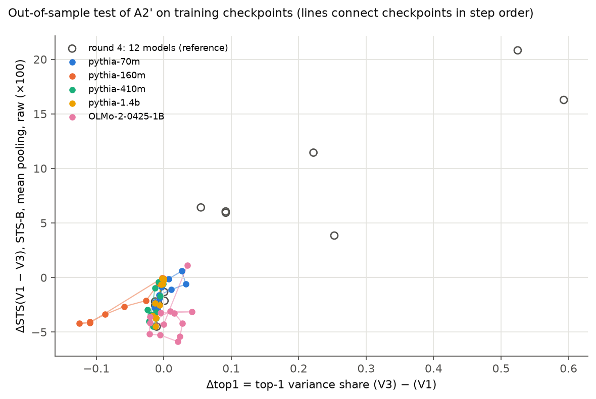

- **P1-1 成立。** 在 5 个训练序列内部，Δtop1 越大（γ 让 V3 比 V1 更集中于一个方差方向），用 V1 相对 V3 的 STS 优势越大。
- **P1-2 不成立。** 在同一个训练序列内部，A_V1 − A_V3 对 ΔSTS 的预测在 4/5 个模型上更好。两个预测量在序列内高度共线（ρ(Δtop1, A 差值) = 0.36 / 0.87 / 0.96 / 0.67 / −0.03，按 70m / 160m / 410m / 1.4b / OLMo-2），所以这一检验区分不了"方差集中"与"均值方向"。
- **范围限制。** checkpoint 的 Δtop1 只在 −0.13 到 +0.04 之间，远小于第四轮跨模型样本中的 0.05 – 0.6（gpt2、gpt2-medium、Qwen 系列）。ΔSTS 在 −5.9 到 +1.1 之间，59 个 checkpoint 中 49 个的 95% CI 在 0 以下（V3 更好），只有 1 个在 0 以上。也就是说，这些训练中的模型没有一个像 GPT-2 small/medium 那样被 γ 推向强方差集中。第四轮 A2' 关系中起决定作用的那一端（Δtop1 > 0.2），本次样本外检验没有覆盖到。
- **次要终点（只报告）。** STS-B EOL、SICK-R mean、SICK-R EOL 上的 ρ_top1 大多为正（0.44 – 0.92）。例外是 410m 的 SICK-R mean：ρ_top1 = −0.73，ρ_A = −0.72，方向相反。

### R5.2 第 2 项：与 Godey 等人（2024）饱和现象的联系

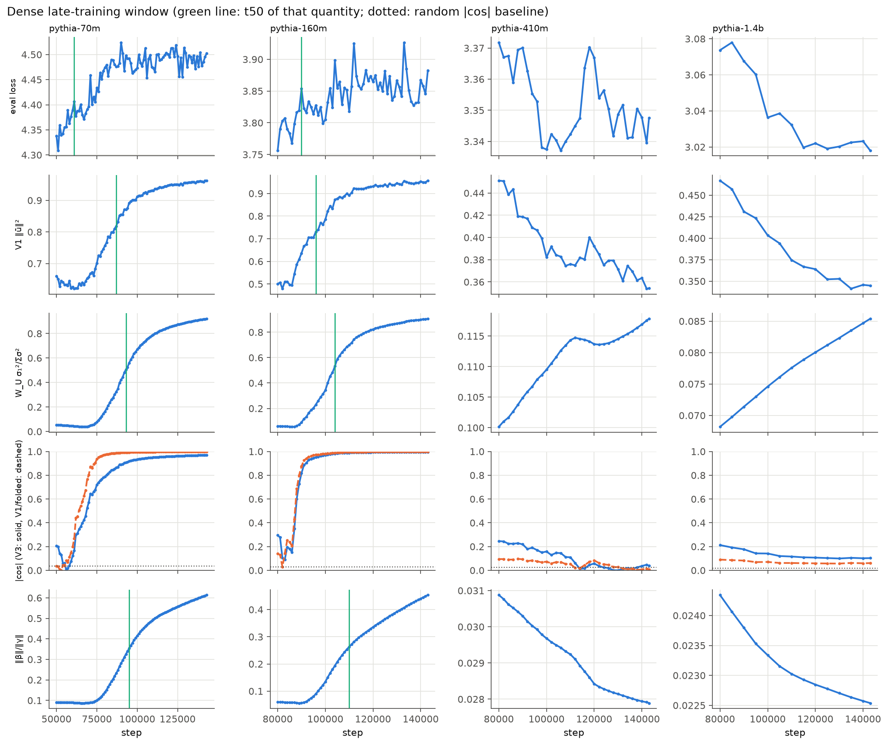

- **奇异熵的定义。** Godey 等人原文（Section 4.2）只写了"computed as the Kullback-Leibler divergence between the normalized singular value distribution and the uniform distribution"，没有公式，也没有说明用 σ 还是 σ²、是否中心化。按任务书同时报告两个版本（W_U 不中心化）：70m 的 KL(σ) 从窗口起点的 0.033 升到 0.548，KL(σ²) 从 0.23 升到 5.50；160m 为 0.033 → 0.438、0.28 → 5.75。410m / 1.4b 在窗口内几乎不变（KL(σ) 0.034 → 0.035 / 0.033 → 0.032）。
- **头部谱的尖峰。** 70m 的 σ₁²/Σσ² 从 0.054 升到 0.921，σ₁/σ₂ 从 2.6 升到 18.6，有效秩从 495 降到 296；160m 为 0.061 → 0.906、1.9 → 11.3、743 → 495。410m / 1.4b 的 σ₁²/Σσ² 只从 0.100 升到 0.118、从 0.068 升到 0.085。
- **先后顺序（Q2-1）。** 70m 与 160m 的顺序相同：评估 loss 的上升最早（t50 = 61000 / 90000），然后是 V1 ‖ū‖² 的坍缩（87000 / 96000），然后是头部谱尖峰（93000 / 104000），最后是 ‖β‖/‖γ‖（95000 / 110000）。按预登记判定为 H-rep。注意：评估 loss 在相邻 checkpoint 间的波动约为 ±0.02 – 0.03，而窗口内总上升只有 0.19 / 0.13，所以 loss 的 t50 不稳定（70m 的最小值出现在 step 51000，是一个低于两侧的单点）。V1、头部谱、β/γ 三条曲线都很平滑，它们之间的先后是可靠的。
- **方向对齐（Q2-2，新发现）。** 坍缩之后，残差流的公共方向 ū 与头部第一右奇异向量几乎重合：70m step 143000 的 \|cos\| 为 0.970（V3 对 W_U）/ 0.999（V1 对 W_U·diag γ），160m 为 0.996 / 0.998。随机基线约为 0.03。ū 在 W_U 前 1 个右奇异向量上的平方占比从 0.04（70m step 50000）升到 0.94（step 143000）。410m / 1.4b 在终点的 \|cos\| 只有 0.04 / 0.10（V3 对 W_U）。也就是说，头部的尖峰方向就是残差流的均值方向。从 V1 ‖ū‖² 先于 σ₁²/Σσ² 变化来看，是残差流先集中，头部随后在同一方向上放大，而不是反过来。
- **410m（Q2-3）。** 按预登记定义成立：终点比窗口最小值高 0.0105，V1 isotropy 最低 0.454。但这一上升小于窗口内 checkpoint 间的波动（3.337 – 3.372），不能据此认为 410m 在本评估集上出现了饱和。可以确定的只是：410m 在窗口内没有发生残差流坍缩，也没有头部谱尖峰。
- **Δloss 的二阶预测量（Q2-4）。** ½·E_t Var_{p_t}(δ) 在 1184 个点上与实际 Δloss 的 Spearman 为 0.987，优于同一样本上"词表 sd"的 0.943。对 Δloss > 0.1 的点，预测量 / 实际的中位比值为 0.975。第四轮的矛盾（70m step 143000 前 32 维 corr 为正，但子集 Δloss 7.92 > 全部 3.16）由此得到解释：按模型自己的输出分布加权，前 32 维偏移的方差（预测量 9.80）确实大于全部维度（2.97）；在整个词表上不加权计算的 corr 不反映这一点。图 C4 左下的负 Δloss 点（−0.1 – 0）都来自早期 checkpoint，二阶预测量恒 ≥ 0，无法表示"去掉均值反而改善"的情况。

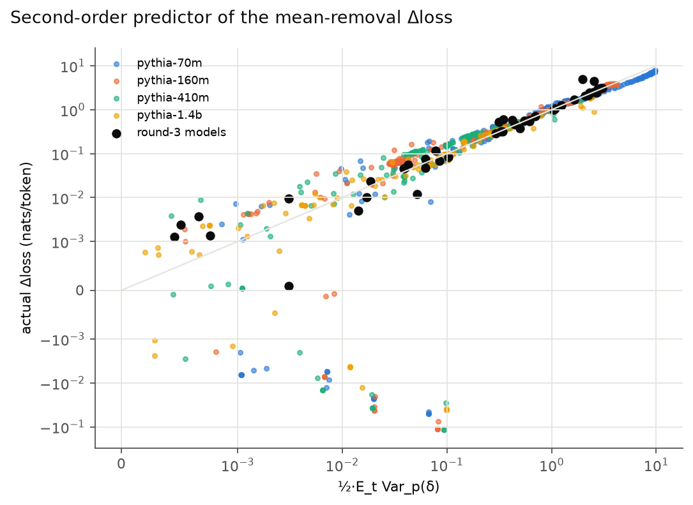

### R5.3 第 3 项：早期瞬态是否就是 unigram 阶段

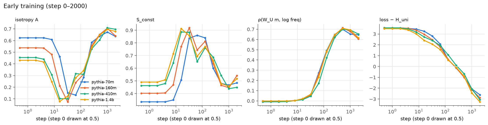

- **H_uni = 7.486 nats**（add-1 平滑的 wikitext-103 train 词频，Pythia tokenizer，9.18 万个评估目标）。
- **"常数输出"阶段与各向异性峰值重合。** 4 个规模的 A 最小值（step 16 – 64，A = 0.075 – 0.132）与 S_const 最大值（0.86 – 0.92）落在同一个或相邻的 checkpoint。在 step 0 – 64 内，S_const 与 V3 的 ‖ū‖² 几乎一一对应（Spearman 0.98 – 1.00）。所以早期的强各向异性就是"各位置输出几乎相同的 logit 向量"的阶段。
- **但这个常数输出还不是词频先验。** A 最小时，ρ(W_U m, log 词频) 只有 0.02 – 0.27，loss 仍比 unigram 模型高 2.1 – 2.5 nats。词频相关在 step 64 – 512 之间逐步上升，到 step 512 达到最大（0.70 – 0.71）。loss 在 step 256 最接近 H_uni（差 0.07 – 0.14），此时 A 已经回升到 0.53 – 0.58，之后低于 H_uni。按预登记，P3-1 与 P3-2 都不成立（0/4）。数据支持的说法是：模型先学会"所有位置输出同一个向量"（各向异性峰值），然后才让这个公共向量变成词频先验（step 64 – 512）；两者不在同一时间。
- **P3-3。** 到 step 1000，S_const 降到峰值的 0.49 – 0.54，A 回升 0.54 – 0.63。只有 160m 和 410m 低于预登记的 0.5 阈值，判定为 2/4，不成立。S_const 在 step 1000 之后仍有 0.44 – 0.47（step 2000 为 0.45 – 0.54），即训练后的模型仍有接近一半的 logit 方差来自位置无关的公共部分。

### R5.4 与 Godey et al. 2024 的逐条对照

依据：用 Undermind 读取的原文（arXiv 2404.07647）。

- **"Pile 上 ≤ 410M 的模型出现饱和"（Section 3）。**
  - 70m / 160m：一致。我们在 wikitext-103 test 上看到 70m 的 loss 从 4.31（step 51000）升到 4.50（step 143000），160m 从 3.76 升到 3.88。
  - 410m：本次不能确认（+0.01，在波动之内）。原文的 410M 也只有文字表述，图 1、图 3 中 410M 的曲线没有明显上升。
- **"≤ 160M 的模型最后一层各向异性陡增"（Section 4.1，平均两两余弦）。** 一致。并且我们把它定位到 final norm 之前的残差流（V1 ‖ū‖² 0.66 → 0.96），γ 与 β 只在其上略有加强（第四轮 R4.4）。原文用的是 final norm 之后的表示，没有做这一分解。
- **"LM head 的奇异值分布先变平，然后突然变成尖峰，与性能下降大致同时"（Section 4.2，图 4、图 5）。** 一致：70m/160m 的 σ₁²/Σσ² 在窗口起点为 0.05 – 0.06，之后升到 0.91 – 0.92；KL 到均匀分布同步上升。补充：原文没有给出先后关系，我们在 1000 step 的分辨率下看到，loss 上升先于残差流坍缩，残差流坍缩先于头部尖峰（相差 6000 – 8000 step）。
- **"后坍缩的主导成分可能与词频相关"（Discussion，作为假设）。** 部分支持：头部第一右奇异方向与残差流均值方向的 \|cos\| ≈ 0.97 – 1.00，而均值方向造成的 logit 偏移 W_U m 与 log 词频的 Spearman 在坍缩前后都约为 0.59 – 0.64。注意这一相关在不坍缩的 410m / 1.4b 中同样存在（0.63），所以它不是坍缩模型特有的。
- **"原因是 softmax bottleneck（隐藏维度太小）"（Section 5）。** 本次没有直接检验。我们的数据只说明坍缩的方向就是残差流的公共均值方向，且残差流先变化。这与"头部容量不足迫使输出退化"的解释并不矛盾，但也没有提供直接证据。

### R5.5 探索性（不在预登记内）

- 第 1 项中，Δtop1 与 A 差值在训练序列内部的共线性（见 R5.1）。
- Δloss 一阶项 E_t[δ_y − E_{p_t} δ] 的绝对值中位数为 0.036（最大 0.76），远小于二阶项。这说明预测量的高相关主要来自模型的校准，而不是巧合。
- 早期阶段 S_const 与 ‖ū‖² 的近乎一一对应（R5.3）。
- 70m 在 step 50000 – 70000 之间，残差流与头部尚未变化（V1 ‖ū‖² 约 0.62 – 0.66，σ₁²/Σσ² 约 0.04 – 0.05），但 loss 已开始上升。如果这不是评估噪声，饱和的起点可能早于任何几何指标的变化。本次的评估集（500 条序列、约 9 万 token）不足以确认。

## 4. 局限

- 第 5 轮：第 1 项的样本外检验只覆盖了 Δtop1 ∈ [−0.13, 0.04]，且序列内两个预测量共线；第 2 项的评估 loss 在相邻 checkpoint 间波动 ±0.02 – 0.03，loss 的 t50 和 410m 的"上升"都受此限制；Godey 的奇异熵定义无法从原文确定，两个版本都报告了，但都不一定是原文的实现；第 3 项的 A 用的是 V3 的 isotropy（早期 γ = 1，与 V1 相同）。
- 第 4 轮 A：STS 只用了两个英文数据集和两种池化，未做 STS12 – 16 等其他集合；拟合集是 WikiText 句子，与 STS 的领域不同，center / zscore / abtt 的统计量因此可能不是最优的；A2 只有 12 个点。
- 第 4 轮 B：Pythia 每个规模只有一个训练 seed，checkpoint 间隔在 step 1000 以后为 1000 – 30000 step，"先后顺序"的判断受这一分辨率限制；OLMo-2 stage1 在 step 300 与 10000 之间没有 branch；massive activation 用的是各维 mean\|h\| 的 max/median，与文献中的单激活比值不同；偏移统计用整个词表，未按词频加权。
- 模型集合不是设计出来的对照：只有两对 base/post-trained；参数量集中在 0.1–1.6B（GPT-2）、7–8B 和 24–33B；每个现代家族最多 3 个点。
- 数据是 wikitext-103 test（≥100 词的段落只有 1085 段，1000 段样本几乎是全集），与原论文不同；截断长度 256。
- 所有模型都用 bf16 前向，原论文可能用 fp32。
- B、C 基于每层 10000 个 token 的 bank、20000 对，单 seed，没有置信区间。
- γ 折算后排序会变（第 3 轮 ρ = 0.48），所以对 `hidden_states[-1]` 做跨模型比较依赖于尺度约定。
- 第 3 轮补充分析中的"中间层 massive activation 维度"用第一轮按 mean\|h\| 排序的离群维度近似（每个选中层只取前 5 维），没有按 token 定位；架构协变量表（R3.7）与家族、规模、数据完全混杂，只作描述。
- 第 3 轮的功能性干预只测了"去掉均值"这一种：它等价于固定的 logit 偏置，测的是输出先验的重要性，不涉及随 token 变化的信息；base→instruct 反事实只平移均值、不改方差，且只有两对模型。

## 5. 可能的下一步（未做）

1. 定位 Qwen2.5 / Qwen3 中去掉位置 0 后仍存在的大范数 token，并给出"去掉所有大范数 token"的 B/C。
2. 补 Qwen3 系列的其他规模（0.6B–14B 的 Base），看 γ 尖峰与最后一层各向异性是否在同一家族内随规模变化。
3. 查 Olmo-3.1 为何没有位置 0 尖峰。第 4 轮：OLMo-2-1B 在整个训练中也没有（≤ 2.9），而 Pythia 都有，与"post-sublayer norm"的解释相容；要区分 norm 位置、QK-norm 形式和训练数据，需要只改其中一项的对照模型。
5. 第 4 轮 A：计算 Parupudi 2026 的"单一最大方差坐标占比"诊断量，把我们的模型按他们的标准分组后重做 A4；补 STS12 – 16；用与 STS 同领域的拟合集。
6. 第 4 轮 B：用 Pythia 的全部 154 个 checkpoint（或 dedup 版本、多 seed 的 PolyPythias）细化 70m/160m 后期坍缩与 γ 翻转的先后顺序；按词频加权重算抵消相关。
4. 是否纳入 GLM-4.5-Air-FP8（FP8 量化 MoE，因精度与协议不符而排除）。

## 文件

`prepare_data.py`、`measure.py`、`diag_final_norm.py`、`analyze.py`、第 3 轮的 `round3_lib.py`、`extract_round3.py`、`analyze_round3.py`、`count_unigrams.py`、补充分析 `analyze_round3b.py`（→ `results/round3/followup.{md,json}`）、第 4 轮的 `prepare_fit_sentences.py`（→ `data/fit_sentences.jsonl`）、`sts_round4.py`、`download_round4.py`、`dyn_round4.py`、`analyze_round4.py`、`slurm/run_sts.sbatch`、`slurm/run_dyn.sbatch`、`configs/round4_ckpts.tsv`、`configs/round4_groups.txt`、`results/round4/`（`sts/`、`dyn/<model>/<revision>.json`、`sts_summary.md`、`dyn_summary.md`、`*_analysis.json`）、`cache/round4_banks/`（每个 checkpoint 的 bank，仅本地）、第 5 轮的 `configs/round5_prereg.md`（预登记）、`round5_gpu.py`、`round5_cpu.py`、`analyze_round5.py`、`slurm/run_sts5.sbatch`、`slurm/run_r5gpu.sbatch`、`slurm/r5cpu.sbatch`、`slurm/unigrams5.sbatch`、`configs/round5_*.tsv|txt`、`results/round5/`（`sts/`、`dyn/`、`logit/`、`spec/`、`summary.md`、`analysis.json`、`h_uni.json`）、`cache/round5_banks/`（仅本地）、`slurm/run_round3.sbatch`、`slurm/unigrams.sbatch`、`results/round3/`、`cache/banks/`（每个模型 fp32 bank，已加入 `.gitignore`）、`tests/test_metrics.py`、`slurm/run_array.sbatch`（+`slurm/env.sh`；已完成的步骤会自动跳过）、`models.txt`、`models_local.md`、`results/*.json`、`results/diag/*.json`、`results/summary.{md,csv}`、`figs/*.png`、`logs/iso_97{25,43}_*.out`（仅本地，不在 git 仓库中）。冒烟测试（各 50 条）的结果在 `results/smoke/`。
